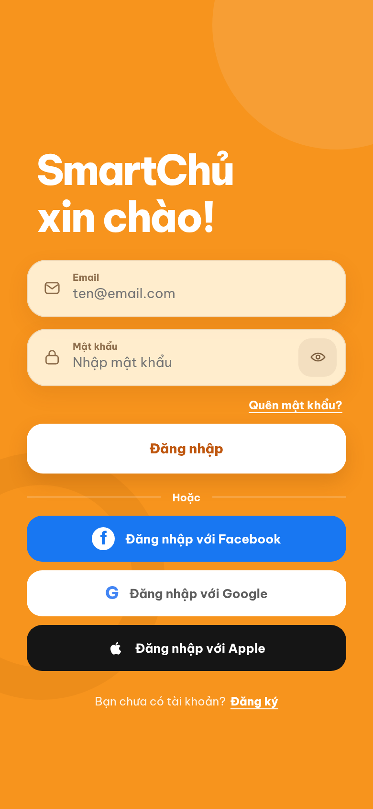
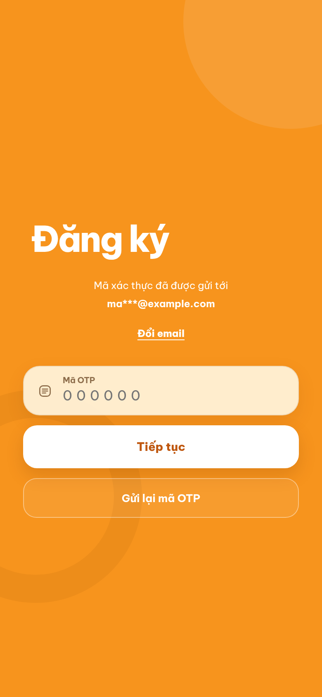

# UC-01 — Đăng ký tài khoản bằng email

## 1. Mô tả Use Case

### 1.1 Thông tin chung

| Trường | Nội dung |
| --- | --- |
| Mã Use Case | UC-01 |
| Tên Use Case | Đăng ký tài khoản bằng email |
| Mục tiêu | Chủ trọ tạo tài khoản SmartChủ bằng email đã xác minh, thông tin cá nhân tối thiểu và mật khẩu. |
| Phạm vi | SmartChủ / Xác thực tài khoản |
| Tác nhân chính | Chủ trọ |
| Tác nhân phụ/Hệ thống liên quan | Hệ thống SmartChủ; dịch vụ gửi email |
| Sự kiện kích hoạt | Chủ trọ chọn `Đăng ký` từ màn hình Đăng nhập. |
| Tiền điều kiện | Chủ trọ chưa đăng nhập; ứng dụng có thể kết nối tới dịch vụ xác thực và gửi email. |
| Hậu điều kiện thành công | Tài khoản được tạo với email đã xác minh và thông tin cá nhân đã cung cấp; chủ trọ được đưa về Đăng nhập với email điền sẵn, không tự động đăng nhập. |
| Đảm bảo tối thiểu khi không thành công | Không tạo tài khoản trùng hoặc chưa hoàn tất; không tạo phiên đăng nhập; OTP và mật khẩu không được lưu bền vững hoặc ghi log. |

### 1.2 Luồng chính

| Bước | Tác nhân/Hệ thống | Hành động hoặc phản hồi | Điều kiện/Quy tắc |
| --- | --- | --- | --- |
| M1 | Chủ trọ | Mở ứng dụng SmartChủ. | Chưa có phiên đăng nhập hợp lệ. |
| M2 | Hệ thống SmartChủ | Hiển thị màn hình Đăng nhập. |  |
| M3 | Chủ trọ | Chọn `Đăng ký`. |  |
| M4 | Hệ thống SmartChủ | Hiển thị màn hình Đăng ký bằng email. |  |
| M5 | Chủ trọ | Nhập email và chọn `Gửi OTP`. | Email là định danh đăng nhập. |
| M6 | Hệ thống SmartChủ | Chuẩn hóa email, kiểm tra định dạng, tính duy nhất và giới hạn gửi mã. |  |
| M7 | Hệ thống SmartChủ | Gửi OTP 6 chữ số tới email và hiển thị màn hình nhập OTP. | Email đủ điều kiện đăng ký. |
| M8 | Chủ trọ | Nhập OTP và chọn `Tiếp tục`. | OTP gồm đủ 6 chữ số. |
| M9 | Hệ thống SmartChủ | Xác thực OTP. | OTP đúng, còn hạn và chưa vượt số lần thử. |
| M10 | Hệ thống SmartChủ | Hiển thị màn hình Thông tin cá nhân. | OTP hợp lệ. |
| M11 | Chủ trọ | Nhập tên hiển thị, tùy chọn nhập SĐT liên hệ và chọn `Tiếp tục`. | Tên bắt buộc; SĐT không bắt buộc, không unique. |
| M12 | Hệ thống SmartChủ | Kiểm tra thông tin cá nhân và hiển thị màn hình Tạo mật khẩu. | Thông tin hợp lệ. |
| M13 | Chủ trọ | Nhập mật khẩu, xác nhận mật khẩu và chọn `Đăng ký`. | Hai giá trị hợp lệ và trùng nhau. |
| M14 | Hệ thống SmartChủ | Tạo tài khoản với email đã xác minh. | Không tạo phiên đăng nhập tự động. |
| M15 | Hệ thống SmartChủ | Thông báo thành công và chuyển về Đăng nhập với email điền sẵn. | Không điền sẵn mật khẩu. |

### 1.3 Luồng thay thế

#### A1. Gửi lại OTP

- Bắt đầu tại: `M8`
- Điều kiện: Chủ trọ chưa nhận được OTP hoặc OTP đã hết hạn và thời gian chờ gửi lại đã kết thúc.

| Bước | Tác nhân/Hệ thống | Hành động hoặc phản hồi |
| --- | --- | --- |
| A1.1 | Chủ trọ | Chọn `Gửi lại mã OTP`. |
| A1.2 | Hệ thống SmartChủ | Kiểm tra giới hạn và gửi OTP mới nếu đủ điều kiện. |
| A1.3 | Hệ thống SmartChủ | Vô hiệu OTP cũ, đặt lại thời gian chờ và giữ màn hình nhập OTP. |

- Kết quả/Điểm quay lại: Quay lại `M8` với OTP mới.

#### A2. Đổi email nhận OTP

- Bắt đầu tại: `M8`
- Điều kiện: Chủ trọ muốn sửa email đang xác minh.

| Bước | Tác nhân/Hệ thống | Hành động hoặc phản hồi |
| --- | --- | --- |
| A2.1 | Chủ trọ | Chọn `Đổi email`. |
| A2.2 | Hệ thống SmartChủ | Xóa OTP đang nhập và đưa chủ trọ về màn hình Email. |
| A2.3 | Chủ trọ | Sửa email và gửi lại yêu cầu OTP. |

- Kết quả/Điểm quay lại: Quay lại `M5`.

### 1.4 Luồng ngoại lệ

#### E1. Email không đủ điều kiện đăng ký

- Bắt đầu tại: `M6`
- Điều kiện: Email sai định dạng, đã gắn với tài khoản hoặc yêu cầu vượt giới hạn.

| Bước | Tác nhân/Hệ thống | Hành động hoặc phản hồi |
| --- | --- | --- |
| E1.1 | Hệ thống SmartChủ | Không gửi OTP và không tạo tài khoản. |
| E1.2 | Hệ thống SmartChủ | Hiển thị phản hồi phù hợp nhưng không làm lộ trạng thái tài khoản ngoài chính sách đã duyệt. |
| E1.3 | Chủ trọ | Sửa email hoặc chuyển sang Đăng nhập. |

- Kết quả/Điểm quay lại: Quay lại `M5` hoặc kết thúc tại màn hình Đăng nhập.

#### E2. OTP không hợp lệ

- Bắt đầu tại: `M9`
- Điều kiện: OTP sai, hết hạn, đã bị thay thế hoặc vượt số lần thử.

| Bước | Tác nhân/Hệ thống | Hành động hoặc phản hồi |
| --- | --- | --- |
| E2.1 | Hệ thống SmartChủ | Từ chối xác minh và hiển thị lỗi tương ứng. |
| E2.2 | Chủ trọ | Nhập lại OTP hoặc yêu cầu gửi mã mới. |

- Kết quả/Điểm quay lại: Quay lại `M8`.

#### E3. Thông tin cá nhân không hợp lệ

- Bắt đầu tại: `M12`
- Điều kiện: Tên hiển thị rỗng sau chuẩn hóa hoặc SĐT có nhập nhưng sai định dạng.

| Bước | Tác nhân/Hệ thống | Hành động hoặc phản hồi |
| --- | --- | --- |
| E3.1 | Hệ thống SmartChủ | Giữ dữ liệu và hiển thị lỗi tại trường tương ứng. |
| E3.2 | Chủ trọ | Chỉnh sửa thông tin và gửi lại. |

- Kết quả/Điểm quay lại: Quay lại `M11`.

#### E4. Mật khẩu không hợp lệ hoặc tạo tài khoản thất bại

- Bắt đầu tại: `M13`
- Điều kiện: Mật khẩu không đạt chính sách, hai giá trị không khớp hoặc hệ thống không thể tạo tài khoản.

| Bước | Tác nhân/Hệ thống | Hành động hoặc phản hồi |
| --- | --- | --- |
| E4.1 | Hệ thống SmartChủ | Không tạo tài khoản và hiển thị lỗi phù hợp. |
| E4.2 | Chủ trọ | Nhập lại mật khẩu hoặc thử lại. |

- Kết quả/Điểm quay lại: Quay lại `M13`.

### 1.5 Quy tắc nghiệp vụ

| Mã | Quy tắc nghiệp vụ | Áp dụng tại bước |
| --- | --- | --- |
| BR-01 | Email là định danh đăng nhập duy nhất; email được trim và chuẩn hóa trước khi kiểm tra định dạng và tính duy nhất. | M5-M6 |
| BR-02 | OTP gồm 6 chữ số, có hiệu lực 10 phút và tối đa 5 lần nhập sai cho mỗi lần xác minh. | M7-M9 |
| BR-03 | Gửi lại OTP có thời gian chờ tối thiểu 60 giây, tối đa 5 lần trong một giờ cho mỗi email; hệ thống áp dụng thêm giới hạn chống lạm dụng theo IP hoặc thiết bị. | A1 |
| BR-04 | OTP mới làm OTP cũ mất hiệu lực. | A1.3 |
| BR-05 | Tên hiển thị bắt buộc; SĐT là contact tùy chọn, editable, không unique và không dùng để đăng nhập hoặc nhận OTP trong UC này. | M11-M12 |
| BR-06 | Mật khẩu có tối thiểu 8 ký tự, gồm ít nhất một chữ hoa, một chữ số và một ký tự đặc biệt; xác nhận mật khẩu phải trùng khớp. | M13 |
| BR-07 | OTP, mật khẩu và xác nhận mật khẩu không được ghi nhật ký, đưa vào tham số điều hướng hoặc lưu trong vùng lưu trữ bền vững. | M8-M14 |
| BR-08 | Khi ứng dụng chuyển nền rồi quay lại và phiên đăng ký còn hiệu lực, hệ thống giữ bước hiện tại cùng email; không khôi phục OTP hoặc mật khẩu sau khi tiến trình bị đóng. | M7-M13 |
| BR-09 | Đăng ký thành công không tự động đăng nhập; chỉ điền sẵn email tại màn hình Đăng nhập. | M14-M15 |
| BR-10 | Nút đăng ký mạng xã hội chỉ hiển thị khi chức năng tương ứng đã được phê duyệt; hành vi đăng ký qua mạng xã hội không thuộc UC này. | M4 |

## 2. Activity Diagram

- File nguồn: [SmartChu-auth-email.drawio.xml](../activity-diagrams/SmartChu-auth-email.drawio.xml)
- Page: `AD_Sign Up (By Email)`

## 3. Mô tả màn hình

### 01 — Đăng nhập

#### Thông tin chung

| Trường | Nội dung |
| --- | --- |
| Mã màn hình | 01 |
| Tên màn hình | Đăng nhập |
| Mục đích | Cung cấp điểm vào luồng đăng ký. |
| Điểm vào | Chủ trọ mở SmartChủ khi chưa có phiên hợp lệ. |
| Điểm ra/Điều hướng | `Đăng ký` mở màn hình 02; hành vi đăng nhập thuộc UC-02. |
| Vai trò/Quyền | Chủ trọ chưa đăng nhập. |

#### Thành phần giao diện

| STT | Thành phần | Loại | Nội dung/Dữ liệu hiển thị | Bắt buộc | Có thể chỉnh sửa | Validation/Định dạng | Điều kiện hiển thị |
| --- | --- | --- | --- | --- | --- | --- | --- |
| 1 | Link đăng ký | Liên kết | `Đăng ký` trong lời nhắc chưa có tài khoản | Không | Không | Không áp dụng | Luôn hiển thị. |

#### Thao tác

| Thao tác | Điều kiện khả dụng | Xác nhận | Hệ thống xử lý | Kết quả/Điều hướng | Phản hồi lỗi |
| --- | --- | --- | --- | --- | --- |
| Chọn `Đăng ký` | Luôn khả dụng | Không | Khởi tạo luồng đăng ký. | Mở màn hình 02. | Giữ nguyên màn hình nếu không thể điều hướng. |

#### Trạng thái màn hình

| Trạng thái | Điều kiện | Hiển thị/Hành vi |
| --- | --- | --- |
| Ban đầu | Chưa có phiên đăng nhập | Hiển thị form đăng nhập và link `Đăng ký`. |

### 02 — Đăng ký / Email

#### Thông tin chung

| Trường | Nội dung |
| --- | --- |
| Mã màn hình | 02 |
| Tên màn hình | Đăng ký / Email |
| Mục đích | Thu thập email và yêu cầu OTP xác minh. |
| Điểm vào | Từ `Đăng ký` tại màn hình 01 hoặc `Đổi email` tại màn hình 03. |
| Điểm ra/Điều hướng | Gửi OTP thành công mở màn hình 03; `Đăng nhập` quay về màn hình 01. |
| Vai trò/Quyền | Chủ trọ chưa đăng nhập. |

#### Thành phần giao diện

| STT | Thành phần | Loại | Nội dung/Dữ liệu hiển thị | Bắt buộc | Có thể chỉnh sửa | Validation/Định dạng | Điều kiện hiển thị |
| --- | --- | --- | --- | --- | --- | --- | --- |
| 1 | Email | Trường nhập | Email đăng ký | Có | Có | Định dạng email; trim khoảng trắng; không tự viết hoa | Luôn hiển thị. |
| 2 | Gửi OTP | Nút chính | `Gửi OTP` | Không | Không | Chỉ khả dụng khi email hợp lệ và không đang xử lý | Luôn hiển thị. |
| 3 | Nhóm đăng ký mạng xã hội | Nút phụ | Facebook, Google, Apple | Không | Không | Không thực hiện đăng ký qua mạng xã hội trong UC này | Khi chức năng tương ứng đã được phê duyệt và bật. |
| 4 | Link đăng nhập | Liên kết | `Đã có tài khoản? Đăng nhập` | Không | Không | Không áp dụng | Luôn hiển thị. |

#### Thao tác

| Thao tác | Điều kiện khả dụng | Xác nhận | Hệ thống xử lý | Kết quả/Điều hướng | Phản hồi lỗi |
| --- | --- | --- | --- | --- | --- |
| Chọn `Gửi OTP` | Email hợp lệ; không đang gửi | Không | Kiểm tra email và gửi OTP nếu đủ điều kiện. | Mở màn hình 03. | Hiển thị lỗi phù hợp; không tiết lộ trạng thái tài khoản ngoài chính sách. |
| Chọn `Đăng nhập` | Luôn khả dụng | Không | Hủy luồng đăng ký. | Quay về màn hình 01. | Không áp dụng. |

#### Trạng thái màn hình

| Trạng thái | Điều kiện | Hiển thị/Hành vi |
| --- | --- | --- |
| Ban đầu | Chưa có email hợp lệ | Nút `Gửi OTP` chưa khả dụng. |
| Đang gửi | Đã gửi yêu cầu OTP | Khóa thao tác gửi lặp. |
| Lỗi validation | Email rỗng hoặc sai định dạng | Hiển thị lỗi tại trường email. |
| Lỗi xử lý | Email không đủ điều kiện hoặc gửi thất bại | Giữ email và cho phép sửa hoặc thử lại. |

### 03 — Đăng ký / OTP

#### Thông tin chung

| Trường | Nội dung |
| --- | --- |
| Mã màn hình | 03 |
| Tên màn hình | Đăng ký / OTP |
| Mục đích | Xác minh quyền sở hữu email đăng ký. |
| Điểm vào | Sau khi yêu cầu gửi OTP được chấp nhận. |
| Điểm ra/Điều hướng | OTP hợp lệ mở màn hình 04; `Đổi email` quay về màn hình 02. |
| Vai trò/Quyền | Chủ trọ có phiên đăng ký còn hiệu lực. |

#### Thành phần giao diện

| STT | Thành phần | Loại | Nội dung/Dữ liệu hiển thị | Bắt buộc | Có thể chỉnh sửa | Validation/Định dạng | Điều kiện hiển thị |
| --- | --- | --- | --- | --- | --- | --- | --- |
| 1 | Nơi nhận mã | Văn bản | `Mã xác thực đã được gửi tới` và email masked ở dòng riêng | Không | Không | Email được che một phần | Luôn hiển thị. |
| 2 | Đổi email | Liên kết | `Đổi email` | Không | Không | Không áp dụng | Luôn hiển thị. |
| 3 | OTP | Trường nhập | Mã xác thực | Có | Có | Tối đa 6 chữ số; cho phép dán toàn bộ mã | Luôn hiển thị. |
| 4 | Gửi lại mã | Liên kết/Nút phụ | `Gửi lại mã OTP` kèm thời gian chờ | Không | Không | Tuân theo giới hạn gửi lại | Bị khóa trong thời gian chờ. |
| 5 | Tiếp tục | Nút chính | `Tiếp tục` | Không | Không | Chỉ khả dụng khi đủ 6 số và không đang xác thực | Luôn hiển thị. |

#### Thao tác

| Thao tác | Điều kiện khả dụng | Xác nhận | Hệ thống xử lý | Kết quả/Điều hướng | Phản hồi lỗi |
| --- | --- | --- | --- | --- | --- |
| Chọn `Tiếp tục` | OTP đủ 6 chữ số | Không | Xác thực OTP. | Mở màn hình 04 khi hợp lệ. | Hiển thị lỗi OTP tương ứng. |
| Chọn `Gửi lại mã OTP` | Thời gian chờ đã kết thúc | Không | Gửi OTP mới và vô hiệu OTP cũ. | Ở lại màn hình, đặt lại thời gian chờ. | Thông báo không thể gửi lại. |
| Chọn `Đổi email` | Luôn khả dụng | Không | Xóa OTP đã nhập. | Quay về màn hình 02. | Không áp dụng. |

#### Trạng thái màn hình

| Trạng thái | Điều kiện | Hiển thị/Hành vi |
| --- | --- | --- |
| Chờ nhập | OTP chưa đủ 6 số | Nút `Tiếp tục` chưa khả dụng. |
| Đang xác thực | Đã gửi OTP để kiểm tra | Khóa thao tác gửi lặp. |
| Đang chờ gửi lại | Chưa tới thời điểm gửi lại | Hiển thị thời gian còn lại. |
| Lỗi OTP | OTP không hợp lệ | Giữ màn hình và cho phép nhập lại theo giới hạn. |

### 04 — Đăng ký / Cá nhân

#### Thông tin chung

| Trường | Nội dung |
| --- | --- |
| Mã màn hình | 04 |
| Tên màn hình | Đăng ký / Cá nhân |
| Mục đích | Thu thập thông tin cá nhân tối thiểu. |
| Điểm vào | Sau khi OTP được xác minh. |
| Điểm ra/Điều hướng | Thông tin hợp lệ mở màn hình 05; quay lại trở về màn hình 03. |
| Vai trò/Quyền | Chủ trọ đã xác minh email trong phiên đăng ký hiện tại. |

#### Thành phần giao diện

| STT | Thành phần | Loại | Nội dung/Dữ liệu hiển thị | Bắt buộc | Có thể chỉnh sửa | Validation/Định dạng | Điều kiện hiển thị |
| --- | --- | --- | --- | --- | --- | --- | --- |
| 1 | Tên hiển thị | Trường nhập | Tên hiển thị trong ứng dụng | Có | Có | Trim khoảng trắng; không rỗng sau chuẩn hóa | Luôn hiển thị. |
| 2 | Số điện thoại | Trường nhập | SĐT liên hệ | Không | Có | Kiểm tra định dạng khi có nhập; không unique | Luôn hiển thị. |
| 3 | Tiếp tục | Nút chính | `Tiếp tục` | Không | Không | Chỉ khả dụng khi tên hợp lệ và không đang xử lý | Luôn hiển thị. |

#### Thao tác

| Thao tác | Điều kiện khả dụng | Xác nhận | Hệ thống xử lý | Kết quả/Điều hướng | Phản hồi lỗi |
| --- | --- | --- | --- | --- | --- |
| Chọn `Tiếp tục` | Thông tin hợp lệ | Không | Kiểm tra và giữ thông tin trong phiên đăng ký. | Mở màn hình 05. | Hiển thị lỗi tại trường không hợp lệ. |
| Quay lại | Không đang xử lý | Không | Giữ thông tin cá nhân trong phiên đăng ký; xóa OTP khỏi ô nhập. | Trở về màn hình 03. | Không áp dụng. |

#### Trạng thái màn hình

| Trạng thái | Điều kiện | Hiển thị/Hành vi |
| --- | --- | --- |
| Ban đầu | Chưa có tên hợp lệ | Nút `Tiếp tục` chưa khả dụng. |
| Hợp lệ | Tên hợp lệ; SĐT trống hoặc đúng định dạng | Cho phép tiếp tục. |
| Lỗi validation | Một trường không hợp lệ | Giữ dữ liệu và hiển thị lỗi tương ứng. |

### 05 — Đăng ký / Mật khẩu

#### Thông tin chung

| Trường | Nội dung |
| --- | --- |
| Mã màn hình | 05 |
| Tên màn hình | Đăng ký / Mật khẩu |
| Mục đích | Tạo mật khẩu cho tài khoản có email đã xác minh. |
| Điểm vào | Sau khi thông tin cá nhân hợp lệ. |
| Điểm ra/Điều hướng | Thành công về màn hình 01; quay lại trở về màn hình 04. |
| Vai trò/Quyền | Chủ trọ có phiên đăng ký hợp lệ. |

#### Thành phần giao diện

| STT | Thành phần | Loại | Nội dung/Dữ liệu hiển thị | Bắt buộc | Có thể chỉnh sửa | Validation/Định dạng | Điều kiện hiển thị |
| --- | --- | --- | --- | --- | --- | --- | --- |
| 1 | Mật khẩu | Trường mật khẩu | Mật khẩu tài khoản | Có | Có | Tối thiểu 8 ký tự, có chữ hoa, chữ số và ký tự đặc biệt | Luôn hiển thị. |
| 2 | Xác nhận mật khẩu | Trường mật khẩu | Nhập lại mật khẩu | Có | Có | Phải trùng mật khẩu | Luôn hiển thị. |
| 3 | Hiện/ẩn mật khẩu | Nút biểu tượng | Đổi trạng thái che ký tự | Không | Không | Không thay đổi giá trị | Khi trường mật khẩu hiển thị. |
| 4 | Đăng ký | Nút chính | `Đăng ký` | Không | Không | Chỉ khả dụng khi hai trường hợp lệ và khớp | Luôn hiển thị. |

#### Thao tác

| Thao tác | Điều kiện khả dụng | Xác nhận | Hệ thống xử lý | Kết quả/Điều hướng | Phản hồi lỗi |
| --- | --- | --- | --- | --- | --- |
| Chọn `Đăng ký` | Hai mật khẩu hợp lệ và khớp | Không | Tạo tài khoản. | Thông báo thành công; về màn hình 01 với email điền sẵn. | Hiển thị lỗi validation hoặc lỗi tạo tài khoản. |
| Quay lại | Không đang tạo tài khoản | Không | Xóa hai giá trị mật khẩu. | Trở về màn hình 04. | Không áp dụng. |

#### Trạng thái màn hình

| Trạng thái | Điều kiện | Hiển thị/Hành vi |
| --- | --- | --- |
| Ban đầu | Chưa nhập đủ hai trường | Nút `Đăng ký` chưa khả dụng. |
| Lỗi validation | Mật khẩu không đạt chính sách hoặc không khớp | Hiển thị lỗi tương ứng. |
| Đang tạo tài khoản | Đã gửi yêu cầu hợp lệ | Khóa thao tác gửi lặp. |
| Thành công | Tài khoản được tạo | Thông báo thành công và về Đăng nhập. |
| Lỗi xử lý | Không thể tạo tài khoản | Không tạo phiên; cho phép thử lại. |
