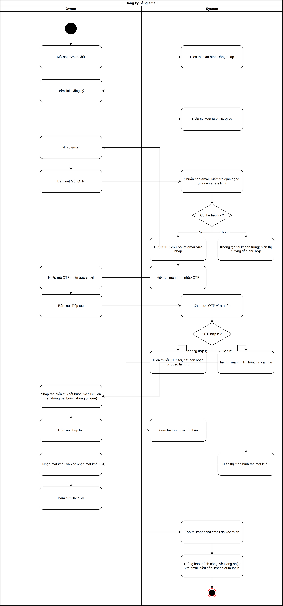
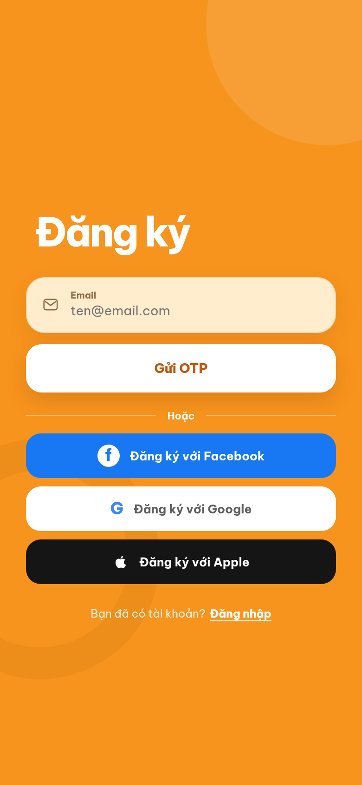
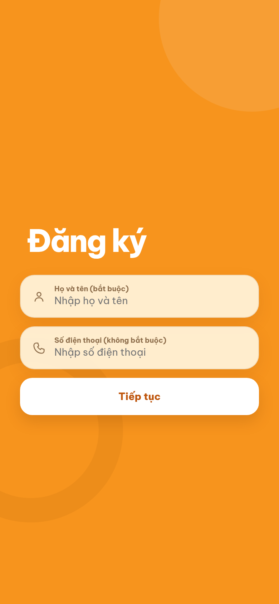
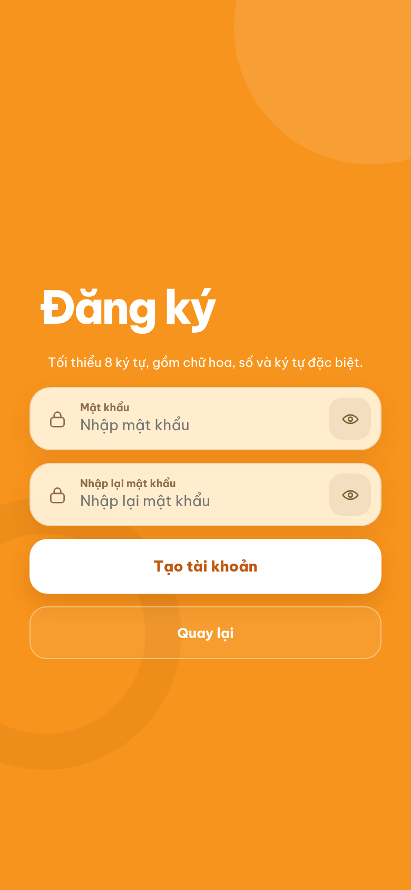

# SmartChủ — UC-01 Sign Up by Email Implementation Specification

## 1. Metadata

| Thuộc tính | Giá trị |
| --- | --- |
| Use Case | `UC-01` — Đăng ký bằng email |
| Actor | Chủ trọ |
| Trạng thái | Draft — canonical Auth canvas đã bổ sung; implementation gate chưa mở |
| Ngày cập nhật | 2026-11-18 |
| Parent task | `GLI-76` |
| Source lịch sử | `SRS/SRS (SmartChủ).docx` — SHA-256 `fc374c30bc5c6777cb4bd7f6d8e48988b9dc801bd6b203d72fbd19b4469b58ab` |

## 1.1. Canonical design reference

- Editable artifact: [`smartchu-auth-flow-canvas-2026-11-18.zip`](../assets/auth/smartchu-auth-flow-canvas-2026-11-18.zip).
- Artboard thuộc UC-01: `02 - Đăng ký / Email`, `03 - Đăng ký / OTP`, `04 - Đăng ký / Cá nhân`, `05 - Đăng ký / Mật khẩu`.
- OTP destination block đã được PO thống nhất với Forgot Password: `Mã xác thực đã được gửi tới` → email masked được nhấn mạnh ở dòng riêng → `Đổi email`.
- Canvas follow visual family màn Đăng nhập SmartChủ, giữ nguyên field/flow đã chốt và không bổ sung image upload, BE/API hoặc business rule mới.

Capture happy path được đặt tại đúng đặc tả màn hình ở mục 4. ZIP ở trên chỉ dùng khi cần mở/chỉnh editable canvas.

- Activity Diagram canonical: [`SmartChu-auth-email.drawio.xml`](../activity-diagrams/SmartChu-auth-email.drawio.xml), page `AD_Sign Up (By Email)`, page ID `JILn1wLlLSULYWfJQ6J8`.
- Các node trọng tâm: email `PuV6NnfnilUMN9S_Ymnt-7`, OTP decision `PuV6NnfnilUMN9S_Ymnt-27`, Personal info `auth-personal-input`, tạo tài khoản `PuV6NnfnilUMN9S_Ymnt-36`.

### Activity Diagram render — Sign Up by Email

PNG này là bản đọc/review được export trực tiếp từ page canonical nêu trên; mọi thay đổi XML phải regenerate ảnh trong cùng revision.

## 2. Mục tiêu và thay đổi nguồn

Chủ trọ tạo tài khoản theo chuỗi Email -> OTP -> Personal info -> Password. Personal info gồm display name bắt buộc và phone optional contact; phone không là credential hay unique identity. Đề xuất này thay thế flow số điện thoại/SMS trong SRS SmartChủ cũ.

| Nội dung cũ | Baseline đề xuất hiện tại |
| --- | --- |
| Số điện thoại là định danh đăng ký | Email normalized là định danh đăng nhập duy nhất |
| OTP qua SMS | OTP 6 chữ số qua email |
| Mật khẩu xử lý theo mô tả SHA-256 cũ | Mật khẩu tuân theo auth platform hiện hành; không lưu/hash bằng SHA-256 thuần |
| Behavior sau đăng ký chưa thống nhất | Trở về Sign In, prefill email; không auto-login |

Số điện thoại được thu thập ngay ở bước Personal info dưới dạng contact không bắt buộc, editable và không unique; không phải credential/identity đăng nhập.

## 3. Luồng đề xuất

1. Chủ trọ nhập email.
2. FE chuẩn hóa định dạng và gửi yêu cầu OTP.
3. Hệ thống trả response chống enumeration phù hợp và gửi OTP email nếu hợp lệ.
4. Chủ trọ nhập OTP 6 chữ số.
5. Sau khi OTP hợp lệ, chủ trọ cung cấp personal info: display name bắt buộc và phone optional contact.
6. Chủ trọ nhập mật khẩu và xác nhận mật khẩu.
7. Hệ thống tạo tài khoản SmartChủ đã xác minh email và khởi tạo `businessVerificationStatus = NOT_SUBMITTED`.
8. App trở về Sign In với email được điền sẵn; không giữ OTP hoặc mật khẩu.

## 4. UI specification

### 4.1. Màn nhập email

- Field `Email` bắt buộc; trim/lowercase theo shared identity normalization.
- Primary action `Gửi OTP`; không gửi request khi format không hợp lệ hoặc đang xử lý.
- Link `Đã có tài khoản? Đăng nhập` quay về Sign In.

### 4.2. Màn nhập OTP

- Destination block: `Mã xác thực đã được gửi tới`, email masked ở dòng riêng được nhấn mạnh, sau đó là action `Đổi email`.
- OTP chỉ nhận 6 chữ số; `Tiếp tục` disabled khi chưa đủ mã hoặc đang verify.
- `Gửi lại mã OTP` tuân theo cooldown; lỗi OTP giữ người dùng ở màn này.

### 4.3. Màn Personal info

- `Tên hiển thị`: bắt buộc, editable.
- `Số điện thoại`: không bắt buộc, editable, non-unique và chỉ dùng làm contact.
- Primary action `Tiếp tục`; không chuyển bước khi tên hiển thị chưa hợp lệ.

### 4.4. Màn tạo mật khẩu

- Hai field mật khẩu và xác nhận mật khẩu; có show/hide và không persist/log.
- Primary action `Đăng ký` chỉ khả dụng khi hai giá trị hợp lệ và khớp nhau.
- Thành công: về Sign In với email prefill; không auto-login.

## 5. Business và security rules

- Email được trim và normalize theo shared identity contract trước khi kiểm tra unique.
- Display name là personal-profile field bắt buộc; phone là contact optional, editable, non-unique và không phải credential. Visual/state happy path theo mục 4.3; operational error state phải bám rule tại UC này khi mở FE gate.
- OTP có TTL `10 phút`; cooldown gửi lại `60 giây`; OTP mới làm OTP cũ mất hiệu lực.
- OTP không được lưu/log dưới dạng đọc được và không được đưa vào navigation params hoặc persistent storage.
- Password policy: tối thiểu 8 ký tự, có ít nhất 1 chữ hoa, 1 số và 1 ký tự đặc biệt, trừ khi PO duyệt policy khác cho toàn platform.
- Khi app chỉ background/foreground và process còn sống, giữ bước hiện tại cùng email không nhạy cảm; không render/reload flow từ đầu nếu state còn hợp lệ.
- Khi app bị force-close/restart, không khôi phục OTP/mật khẩu; người dùng đi lại từ đầu Sign Up.
- Đăng ký social không thuộc UC này và cần UC riêng, bao gồm account social-only dùng cùng email.
- Xác minh email không đồng nghĩa được phép vận hành cho thuê. Quyền tạo nhà, phòng và hợp đồng tuân theo [chính sách xác minh kinh doanh SmartChủ](../../../../archieve/supplemental/Business_Rules/SmartChu/11-smartchu-business-verification-policy.md).

## 6. Acceptance Criteria

### AC-SMC-SU-01 — Đăng ký thành công

- **Given** email chưa gắn với tài khoản SmartChủ và người dùng nhập OTP, personal info, mật khẩu hợp lệ
- **When** hoàn tất Sign Up
- **Then** hệ thống tạo đúng một tài khoản với email normalized
- **And** hồ sơ kinh doanh khởi tạo ở `NOT_SUBMITTED`
- **And** tài khoản chưa được phép tạo nhà trọ, phòng trọ hoặc hợp đồng
- **And** điều hướng về Sign In với email prefill
- **And** không auto-login.

### AC-SMC-SU-02 — Email đã tồn tại

- **Given** email normalized đã tồn tại
- **When** người dùng yêu cầu đăng ký
- **Then** response và UI không tiết lộ dữ liệu nhạy cảm ngoài behavior đã được PO duyệt
- **And** không tạo tài khoản trùng.

### AC-SMC-SU-03 — OTP

- **Given** người dùng đang ở bước OTP
- **When** OTP sai, hết hạn, vượt số lần thử hoặc đã bị thay bằng OTP mới
- **Then** hệ thống từ chối xác minh với error code có thể map an toàn sang UI
- **And** không tạo account.

### AC-SMC-SU-04 — App lifecycle

- **Given** người dùng rời app tạm thời để đọc email
- **When** quay lại khi process/state còn hợp lệ
- **Then** app giữ đúng bước và email
- **And** không giữ hoặc hiển thị lại mật khẩu/OTP sau restart.

## 7. Implementation notes

- SmartChủ dùng shared backend `smart-platform-services`; không tạo auth database riêng.
- Endpoint tạm `/owner/auth/register` trong foundation không mặc nhiên là contract cuối cùng.
- FE phải dựng và review trước BE.
- Canvas SmartChủ cho bốn bước Email → OTP → Personal info → Password là visual reference canonical; Dev vẫn phải chờ PO mở FE gate và xác nhận đã hiểu Ant Design/import boundary trước khi bắt đầu.

## 8. Điểm chờ PO review

- Xác nhận SmartChủ dùng nguyên password policy, TTL/cooldown và post-registration behavior của SmartTrọ.
- Xác nhận wording chống enumeration và lỗi email đã tồn tại.
- Xác nhận các operational state ngoài happy path khi mở FE gate; canvas hiện tại không tự cấp quyền triển khai.
