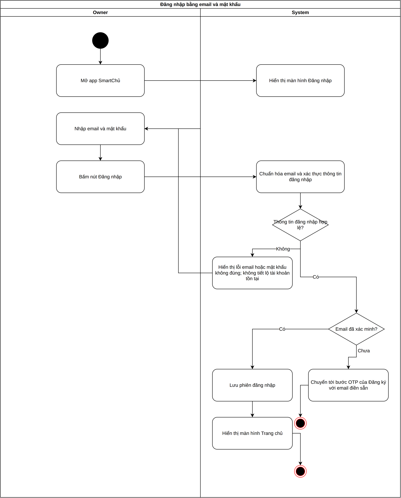

# SmartChủ — UC-02 Sign In / Sign Out Implementation Specification

## 1. Metadata

| Thuộc tính | Giá trị |
| --- | --- |
| Use Case | `UC-02` — Đăng nhập bằng email và mật khẩu; đăng xuất phiên hiện tại |
| Actor | Chủ trọ |
| Trạng thái | Draft — canonical Auth canvas đã bổ sung; implementation gate chưa mở |
| Ngày cập nhật | 2026-11-18 |
| Parent task | `GLI-83` |
| Source lịch sử | `SRS/SRS (SmartChủ).docx` |

## 1.1. Canonical design reference

- Editable artifact: [`smartchu-auth-flow-canvas-2026-11-18.zip`](../assets/auth/smartchu-auth-flow-canvas-2026-11-18.zip).
- Artboard thuộc UC-02: `01 - Đăng nhập`.
- Visual sử dụng theme SmartChủ riêng nhưng cùng Auth layout family và component contract với SmartTrọ; không yêu cầu hai app giống tuyệt đối.
- Canvas chỉ thay presentation. Email/password, session, logout, social feature flag và BE/API contract giữ nguyên.

Capture happy path được đặt tại đặc tả màn Sign In ở mục 5. ZIP chỉ dùng khi cần mở/chỉnh editable canvas.

- Activity Diagram canonical: [`SmartChu-auth-email.drawio.xml`](../activity-diagrams/SmartChu-auth-email.drawio.xml).
- `AD_Sign In (By Email)`, page ID `EaeZUJY0AySNMO07osjg`: credential `llL8XYXRJV3uZxQj6A8Z-46`, decision `llL8XYXRJV3uZxQj6A8Z-62`, nhánh chưa xác minh `auth-resume-signup-otp`.
- `AD_Sign Out`, page ID `x089BlYzUgXplZQq6lxx`: action `8YSoJiMQPqwq8XEEb7fi-15`, revoke/xóa credential `8YSoJiMQPqwq8XEEb7fi-19`.

### Activity Diagram render — Sign In by Email

### Activity Diagram render — Sign Out

Hai PNG là bản đọc/review được export trực tiếp từ hai page canonical; mọi thay đổi XML phải regenerate ảnh trong cùng revision.

## 2. Mục tiêu và thay đổi nguồn

Chủ trọ đăng nhập bằng email và mật khẩu. Flow đăng nhập thông thường **không yêu cầu OTP**. Đề xuất này thay thế SRS cũ dùng số điện thoại và yêu cầu OTP sau credential.

## 3. Luồng đề xuất

1. Chủ trọ nhập email và mật khẩu.
2. FE validate định dạng tối thiểu và gửi request một lần.
3. Backend xác thực email normalized, mật khẩu và trạng thái tài khoản.
4. Nếu hợp lệ, backend tạo session/token theo shared auth contract.
5. App lưu session bằng secure storage phù hợp nền tảng và điều hướng vào Home SmartChủ.

### 3.1. Luồng Sign Out

1. Chủ trọ đang có phiên hợp lệ mở màn Tài khoản.
2. Chủ trọ chọn `Đăng xuất`.
3. Hệ thống thu hồi phiên hiện tại và xóa credential/session cục bộ.
4. App reset auth navigation stack và trở về Sign In.
5. Back navigation không được mở lại dữ liệu bảo vệ của phiên vừa đăng xuất.

## 4. Rules

- Không dùng số điện thoại làm credential.
- Không gửi OTP trong Sign In bình thường.
- Sai email hoặc mật khẩu dùng thông báo chung, không xác nhận tài khoản có tồn tại.
- Account chưa xác minh trả error code riêng cho FE và resume bước OTP của UC-01 với email prefill; không tạo account mới.
- Access token/refresh token không được lưu plaintext trong `localStorage`; mobile dùng secure storage, web dùng cơ chế cookie/token đã được platform duyệt.
- Chặn double-submit và trả UI về trạng thái thao tác được sau timeout/lỗi mạng.
- Sign Out thu hồi/đóng session theo contract, xóa credential cục bộ và trở về Sign In.
- Không tự link/unlink social provider dựa trên email trong UC này.

## 5. UI specification

### 5.1. Màn Sign In

- Hai field `Email` và `Mật khẩu`; email được normalize, mật khẩu không bị biến đổi.
- Primary action `Đăng nhập`; disabled khi dữ liệu chưa hợp lệ hoặc request đang xử lý.
- Link `Quên mật khẩu` sang UC-03; link `Đăng ký` sang UC-01.
- Credential sai dùng thông báo chung; account chưa verify resume OTP của UC-01 với email prefill.
- Social buttons chỉ theo feature flag/phạm vi đã duyệt, không tự suy diễn OAuth behavior từ canvas.

### 5.2. Action Sign Out

- Entry point: màn Tài khoản khi phiên còn hợp lệ; không có màn Auth riêng cho Sign Out.
- Action `Đăng xuất` chỉ xử lý một lần khi đang revoke/xóa credential.
- Thành công: xóa credential cục bộ, reset navigation và về Sign In.
- Revoke server lỗi không được khôi phục credential cục bộ; người dùng vẫn về Sign In.
- Không tự mở rộng thành `Đăng xuất tất cả thiết bị` trong action này.

## 6. Acceptance Criteria

### AC-SMC-SI-01 — Đăng nhập thành công

- **Given** tài khoản email/password đã xác minh và đang active
- **When** người dùng nhập credential đúng
- **Then** hệ thống tạo session hợp lệ
- **And** app điều hướng vào Home SmartChủ.

### AC-SMC-SI-02 — Credential không hợp lệ

- **Given** email hoặc mật khẩu không đúng
- **When** người dùng đăng nhập
- **Then** UI hiển thị thông báo chung
- **And** không tiết lộ email có tồn tại hay không.

### AC-SMC-SI-03 — Account chưa xác minh

- **Given** email/password đúng nhưng account chưa hoàn tất email OTP
- **When** đăng nhập
- **Then** app điều hướng tới bước OTP của UC-01 với email prefill
- **And** không tạo tài khoản hoặc session trùng.

### AC-SMC-SI-04 — Sign Out

- **Given** người dùng đã đăng nhập
- **When** chọn Sign Out
- **Then** session cục bộ bị xóa và backend xử lý refresh/session theo contract
- **And** người dùng trở về Sign In, không xem được dữ liệu bảo vệ bằng Back navigation.

## 7. Implementation notes

- Foundation local đã có email/password validation và SecureStore, nhưng endpoint `/owner/auth/login` và payload hiện tại chỉ là adapter ban đầu, chưa phải contract được duyệt.
- FE phải dựng đúng canonical SmartChủ canvas trước khi map API thật.
- Validation/loading/error state phải được đối chiếu khi PO mở FE gate; Dev không được tự suy diễn từ happy path.

## 8. Điểm chờ PO review

- Xác nhận post-login route/Home state của SmartChủ.
- Xác nhận session duration, multi-device và sign-out-current/all behavior dùng chung toàn platform.
- PO mở implementation gate riêng sau khi tài liệu và operational states đủ rõ; hiện chưa assign/run Dev.
