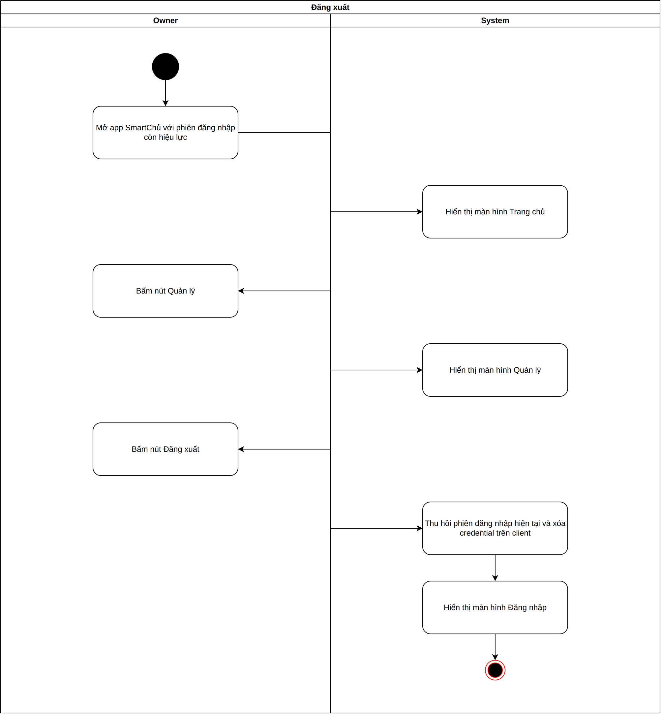
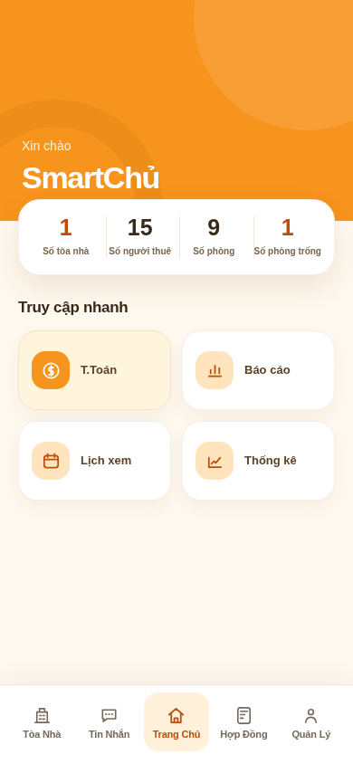
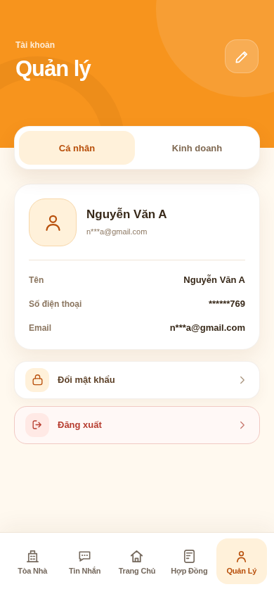

# UC-02 — Đăng nhập và đăng xuất

## 1. Mô tả Use Case

### 1.1 Thông tin chung

| Trường | Nội dung |
| --- | --- |
| Mã Use Case | UC-02 |
| Tên Use Case | Đăng nhập và đăng xuất |
| Mục tiêu | Chủ trọ đăng nhập bằng email và mật khẩu để sử dụng SmartChủ, đồng thời có thể kết thúc phiên hiện tại bằng thao tác đăng xuất. |
| Phạm vi | SmartChủ / Xác thực và quản lý phiên |
| Tác nhân chính | Chủ trọ |
| Tác nhân phụ/Hệ thống liên quan | Hệ thống SmartChủ |
| Sự kiện kích hoạt | Chủ trọ mở ứng dụng khi chưa có phiên hợp lệ hoặc chọn `Đăng xuất` khi đang đăng nhập. |
| Tiền điều kiện | Đăng nhập: tài khoản đã được tạo và chưa có phiên hợp lệ. Đăng xuất: chủ trọ đang có phiên hợp lệ. |
| Hậu điều kiện thành công | Đăng nhập: hệ thống tạo và lưu phiên, sau đó hiển thị Trang chủ. Đăng xuất: phiên hiện tại và thông tin phiên trên thiết bị bị xóa, sau đó hiển thị Đăng nhập. |
| Đảm bảo tối thiểu khi không thành công | Không tạo phiên cho thông tin đăng nhập không hợp lệ; không để chủ trọ truy cập dữ liệu bảo vệ sau khi đã chọn đăng xuất. |

### 1.2 Luồng chính

| Bước | Tác nhân/Hệ thống | Hành động hoặc phản hồi | Điều kiện/Quy tắc |
| --- | --- | --- | --- |
| M1 | Chủ trọ | Mở ứng dụng SmartChủ. | Chưa có phiên đăng nhập hợp lệ. |
| M2 | Hệ thống SmartChủ | Hiển thị màn hình Đăng nhập. |  |
| M3 | Chủ trọ | Nhập email và mật khẩu. |  |
| M4 | Chủ trọ | Chọn `Đăng nhập`. | Dữ liệu đầu vào hợp lệ về định dạng. |
| M5 | Hệ thống SmartChủ | Chuẩn hóa email và xác thực thông tin đăng nhập. | Không thay đổi giá trị mật khẩu. |
| M6 | Hệ thống SmartChủ | Kiểm tra email đã được xác minh. | Credential hợp lệ. |
| M7 | Hệ thống SmartChủ | Tạo và lưu phiên đăng nhập. | Email đã xác minh. |
| M8 | Hệ thống SmartChủ | Hiển thị Trang chủ. |  |
| M9 | Chủ trọ | Chọn `Quản lý` khi muốn kết thúc phiên. | Phiên còn hiệu lực. |
| M10 | Hệ thống SmartChủ | Hiển thị màn hình Quản lý. |  |
| M11 | Chủ trọ | Chọn `Đăng xuất`. |  |
| M12 | Hệ thống SmartChủ | Thu hồi phiên hiện tại và xóa thông tin phiên trên thiết bị. | Xử lý một lần cho mỗi thao tác. |
| M13 | Hệ thống SmartChủ | Xóa auth navigation stack và hiển thị màn hình Đăng nhập. | Back không mở lại dữ liệu của phiên cũ. |

### 1.3 Luồng thay thế

#### A1. Tài khoản chưa xác minh email

- Bắt đầu tại: `M6`
- Điều kiện: Credential đúng nhưng email của tài khoản chưa được xác minh.

| Bước | Tác nhân/Hệ thống | Hành động hoặc phản hồi |
| --- | --- | --- |
| A1.1 | Hệ thống SmartChủ | Không tạo phiên đăng nhập. |
| A1.2 | Hệ thống SmartChủ | Chuyển tới bước OTP của UC-01 với email điền sẵn. |

- Kết quả/Điểm quay lại: Kết thúc UC-02 và tiếp tục tại UC-01.

#### A2. Điều hướng sang đăng ký hoặc quên mật khẩu

- Bắt đầu tại: `M2`
- Điều kiện: Chủ trọ chưa có tài khoản hoặc không nhớ mật khẩu.

| Bước | Tác nhân/Hệ thống | Hành động hoặc phản hồi |
| --- | --- | --- |
| A2.1 | Chủ trọ | Chọn `Đăng ký` hoặc `Quên mật khẩu`. |
| A2.2 | Hệ thống SmartChủ | Mở lần lượt UC-01 hoặc UC-03. |

- Kết quả/Điểm quay lại: Kết thúc UC-02 tại màn hình tương ứng.

### 1.4 Luồng ngoại lệ

#### E1. Email hoặc mật khẩu không đúng

- Bắt đầu tại: `M5`
- Điều kiện: Hệ thống không xác thực được thông tin đăng nhập.

| Bước | Tác nhân/Hệ thống | Hành động hoặc phản hồi |
| --- | --- | --- |
| E1.1 | Hệ thống SmartChủ | Không tạo phiên và hiển thị thông báo chung rằng email hoặc mật khẩu không đúng. |
| E1.2 | Chủ trọ | Sửa thông tin và thử lại. |

- Kết quả/Điểm quay lại: Quay lại `M3`.

#### E2. Không thể hoàn tất đăng nhập

- Bắt đầu tại: `M5`
- Điều kiện: Xảy ra lỗi kết nối, timeout hoặc lỗi xử lý hệ thống.

| Bước | Tác nhân/Hệ thống | Hành động hoặc phản hồi |
| --- | --- | --- |
| E2.1 | Hệ thống SmartChủ | Không tạo phiên, kết thúc trạng thái xử lý và thông báo không thể đăng nhập. |
| E2.2 | Chủ trọ | Thử lại khi điều kiện cho phép. |

- Kết quả/Điểm quay lại: Quay lại `M3`.

#### E3. Thu hồi phiên trên máy chủ thất bại

- Bắt đầu tại: `M12`
- Điều kiện: Hệ thống không thể xác nhận thu hồi phiên với máy chủ.

| Bước | Tác nhân/Hệ thống | Hành động hoặc phản hồi |
| --- | --- | --- |
| E3.1 | Hệ thống SmartChủ | Vẫn xóa thông tin phiên trên thiết bị và thiết lập lại luồng điều hướng xác thực. |
| E3.2 | Hệ thống SmartChủ | Đưa chủ trọ về màn hình Đăng nhập. |

- Kết quả/Điểm quay lại: Tiếp tục tại `M13`.

### 1.5 Quy tắc nghiệp vụ

| Mã | Quy tắc nghiệp vụ | Áp dụng tại bước |
| --- | --- | --- |
| BR-01 | Đăng nhập thông thường sử dụng email và mật khẩu, không yêu cầu OTP. | M3-M7 |
| BR-02 | Email được trim và chuẩn hóa trước khi xác thực; mật khẩu được giữ nguyên khi kiểm tra. | M5 |
| BR-03 | Credential sai phải dùng thông báo chung, không xác nhận email có tồn tại hay không. | E1 |
| BR-04 | Tài khoản chưa xác minh email không được tạo phiên và phải tiếp tục tại bước OTP của UC-01. | A1 |
| BR-05 | Credential phiên phải được lưu bằng cơ chế bảo mật đã được nền tảng phê duyệt; không lưu plaintext trong vùng lưu trữ không an toàn. | M7 |
| BR-06 | Nút `Đăng nhập` và `Đăng xuất` không xử lý lặp khi yêu cầu trước đang chạy. | M4, M11 |
| BR-07 | Đăng xuất phải xóa thông tin phiên trên thiết bị, thiết lập lại luồng điều hướng xác thực và ngăn Back mở lại dữ liệu bảo vệ. | M12-M13 |
| BR-08 | Đăng xuất trong UC này chỉ áp dụng cho phiên hiện tại, không bao gồm `Đăng xuất tất cả thiết bị`. | M11-M12 |
| BR-09 | Nút đăng nhập mạng xã hội chỉ hoạt động khi chức năng và UC tương ứng đã được phê duyệt. | M2 |

## 2. Activity Diagram

- File nguồn: [SmartChu-auth-email.drawio.xml](../activity-diagrams/SmartChu-auth-email.drawio.xml)
- Page: `AD_Sign In (By Email)`

- Page: `AD_Sign Out`

## 3. Mô tả màn hình

### 01 — Đăng nhập

#### Thông tin chung

| Trường | Nội dung |
| --- | --- |
| Mã màn hình | 01 |
| Tên màn hình | Đăng nhập |
| Mục đích | Thu thập thông tin đăng nhập để tạo phiên và cung cấp điều hướng tới đăng ký hoặc khôi phục mật khẩu. |
| Điểm vào | Mở ứng dụng khi chưa có phiên, sau đăng ký, sau đặt lại mật khẩu hoặc sau đăng xuất. |
| Điểm ra/Điều hướng | Thành công tới Trang chủ; `Đăng ký` tới UC-01; `Quên mật khẩu` tới UC-03; tài khoản chưa xác minh tới OTP của UC-01. |
| Vai trò/Quyền | Chủ trọ chưa đăng nhập. |

#### Thành phần giao diện

| STT | Thành phần | Loại | Nội dung/Dữ liệu hiển thị | Bắt buộc | Có thể chỉnh sửa | Validation/Định dạng | Điều kiện hiển thị |
| --- | --- | --- | --- | --- | --- | --- | --- |
| 1 | Email | Trường nhập | Email đăng nhập | Có | Có | Định dạng email; trim; không tự viết hoa | Luôn hiển thị. |
| 2 | Mật khẩu | Trường mật khẩu | Mật khẩu tài khoản | Có | Có | Không biến đổi giá trị; cho phép hiện/ẩn | Luôn hiển thị. |
| 3 | Quên mật khẩu | Liên kết | `Quên mật khẩu` | Không | Không | Không áp dụng | Luôn hiển thị. |
| 4 | Đăng nhập | Nút chính | `Đăng nhập` | Không | Không | Chỉ khả dụng khi dữ liệu hợp lệ và không đang xử lý | Luôn hiển thị. |
| 5 | Nhóm đăng nhập mạng xã hội | Nút phụ | Facebook, Google, Apple | Không | Không | Ngoài phạm vi UC này | Khi chức năng tương ứng đã được phê duyệt và bật. |
| 6 | Đăng ký | Liên kết | Lời nhắc chưa có tài khoản và `Đăng ký` | Không | Không | Không áp dụng | Luôn hiển thị. |

#### Thao tác

| Thao tác | Điều kiện khả dụng | Xác nhận | Hệ thống xử lý | Kết quả/Điều hướng | Phản hồi lỗi |
| --- | --- | --- | --- | --- | --- |
| Chọn `Đăng nhập` | Email và mật khẩu hợp lệ về định dạng | Không | Xác thực thông tin đăng nhập và trạng thái email. | Tới Trang chủ hoặc OTP của UC-01. | Hiển thị lỗi chung hoặc lỗi kết nối; không tiết lộ trạng thái tài khoản. |
| Chọn `Quên mật khẩu` | Luôn khả dụng | Không | Khởi tạo UC-03. | Mở màn hình quên mật khẩu. | Giữ màn hình nếu không thể điều hướng. |
| Chọn `Đăng ký` | Luôn khả dụng | Không | Khởi tạo UC-01. | Mở màn hình đăng ký email. | Giữ màn hình nếu không thể điều hướng. |

#### Trạng thái màn hình

| Trạng thái | Điều kiện | Hiển thị/Hành vi |
| --- | --- | --- |
| Ban đầu | Chưa đủ thông tin đăng nhập | Nút `Đăng nhập` chưa khả dụng. |
| Hợp lệ | Email và mật khẩu đã nhập hợp lệ | Cho phép đăng nhập. |
| Đang xử lý | Đã gửi yêu cầu đăng nhập | Khóa thao tác gửi lặp. |
| Lỗi thông tin đăng nhập | Xác thực thất bại | Hiển thị thông báo chung và cho phép sửa thông tin. |
| Lỗi hệ thống | Kết nối hoặc xử lý thất bại | Kết thúc loading và cho phép thử lại. |

### Trang chủ — Trang chủ

#### Thông tin chung

| Trường | Nội dung |
| --- | --- |
| Mã màn hình | Trang chủ |
| Tên màn hình | Trang chủ |
| Mục đích | Xác nhận chủ trọ đã vào vùng có xác thực và cung cấp lối tới Quản lý. |
| Điểm vào | Sau khi đăng nhập thành công hoặc mở ứng dụng với phiên còn hiệu lực. |
| Điểm ra/Điều hướng | `Quản lý` mở màn hình Quản lý. |
| Vai trò/Quyền | Chủ trọ đã đăng nhập. |

#### Thành phần giao diện

| STT | Thành phần | Loại | Nội dung/Dữ liệu hiển thị | Bắt buộc | Có thể chỉnh sửa | Validation/Định dạng | Điều kiện hiển thị |
| --- | --- | --- | --- | --- | --- | --- | --- |
| 1 | Lời chào | Nội dung | `Xin chào` và tên sản phẩm `SmartChủ` | Không | Không | Không áp dụng | Khi có phiên hợp lệ. |
| 2 | Tổng quan vận hành | Nhóm chỉ số | Số tòa nhà, số người thuê, số phòng và số phòng trống | Không | Không | Giá trị số từ dữ liệu hệ thống | Khi có dữ liệu tương ứng. |
| 3 | Truy cập nhanh | Nhóm action | `T.Toán`, `Báo cáo`, `Lịch xem`, `Thống kê` | Không | Không | Destination thuộc UC tương ứng, không xác định trong UC-02 | Khi action được cung cấp cho tài khoản. |
| 4 | Điều hướng chính | Thanh điều hướng | `Tòa Nhà`, `Tin Nhắn`, `Trang Chủ`, `Hợp Đồng`, `Quản Lý` | Không | Không | `Trang Chủ` là mục đang chọn tại Trang chủ | Khi có phiên hợp lệ. |

#### Thao tác

| Thao tác | Điều kiện khả dụng | Xác nhận | Hệ thống xử lý | Kết quả/Điều hướng | Phản hồi lỗi |
| --- | --- | --- | --- | --- | --- |
| Chọn `Quản Lý` | Phiên hợp lệ | Không | Mở khu vực Quản lý. | Hiển thị màn hình Quản lý tại tab `Cá nhân`. | Yêu cầu đăng nhập lại nếu phiên hết hạn. |

#### Trạng thái màn hình

| Trạng thái | Điều kiện | Hiển thị/Hành vi |
| --- | --- | --- |
| Đã xác thực | Phiên còn hiệu lực | Cho phép truy cập lối vào Quản lý. |
| Phiên hết hạn | Phiên không còn hiệu lực | Xóa thông tin phiên trên thiết bị và chuyển về Đăng nhập. |

### Quản lý — Quản lý

#### Thông tin chung

| Trường | Nội dung |
| --- | --- |
| Mã màn hình | Quản lý |
| Tên màn hình | Quản lý |
| Mục đích | Cung cấp khu vực quản lý tài khoản, trong đó chủ trọ có thể kết thúc phiên hiện tại. |
| Điểm vào | Từ Trang chủ qua mục `Quản Lý`. |
| Điểm ra/Điều hướng | Hoàn tất đăng xuất về màn hình Đăng nhập; các action hồ sơ khác thuộc UC tương ứng. |
| Vai trò/Quyền | Chủ trọ đã đăng nhập. |

#### Thành phần giao diện

| STT | Thành phần | Loại | Nội dung/Dữ liệu hiển thị | Bắt buộc | Có thể chỉnh sửa | Validation/Định dạng | Điều kiện hiển thị |
| --- | --- | --- | --- | --- | --- | --- | --- |
| 1 | Tab Cá nhân | Tab | Thông tin personal profile | Không | Không | Tab mặc định | Luôn hiển thị trong khu vực Quản lý. |
| 2 | Tab Kinh doanh | Tab | Lối sang bề mặt thông tin kinh doanh | Không | Không | Thuộc UC riêng | Luôn hiển thị trong khu vực Quản lý. |
| 3 | Thông tin tài khoản | Nhóm dữ liệu | Avatar/fallback, tên hiển thị, phone contact nếu có và email read-only | Không | Không | Theo UC-04 | Khi tab `Cá nhân` được chọn. |
| 4 | Đổi mật khẩu | Action | `Đổi mật khẩu` | Không | Không | Thuộc UC-08 | Khi có phiên hợp lệ. |
| 5 | Đăng xuất | Nút/Action | `Đăng xuất` | Không | Không | Chỉ xử lý một lần khi đang đăng xuất | Khi có phiên hợp lệ. |
| 6 | Điều hướng chính | Thanh điều hướng | `Tòa Nhà`, `Tin Nhắn`, `Trang Chủ`, `Hợp Đồng`, `Quản Lý` | Không | Không | `Quản Lý` là mục đang chọn tại màn hình Quản lý | Khi có phiên hợp lệ. |

#### Thao tác

| Thao tác | Điều kiện khả dụng | Xác nhận | Hệ thống xử lý | Kết quả/Điều hướng | Phản hồi lỗi |
| --- | --- | --- | --- | --- | --- |
| Chọn `Đăng xuất` | Phiên hợp lệ; không đang xử lý | Không | Thu hồi phiên hiện tại, xóa thông tin phiên trên thiết bị và thiết lập lại luồng điều hướng. | Về màn hình Đăng nhập. | Nếu máy chủ lỗi, vẫn xóa thông tin phiên trên thiết bị và về Đăng nhập. |

#### Trạng thái màn hình

| Trạng thái | Điều kiện | Hiển thị/Hành vi |
| --- | --- | --- |
| Sẵn sàng | Phiên hợp lệ | Tab `Cá nhân` hiển thị mặc định và action `Đăng xuất` khả dụng. |
| Đang đăng xuất | Đã chọn action | Khóa thao tác lặp. |
| Hoàn tất | Credential cục bộ đã xóa | Chuyển về Đăng nhập và không cho Back vào vùng bảo vệ. |
