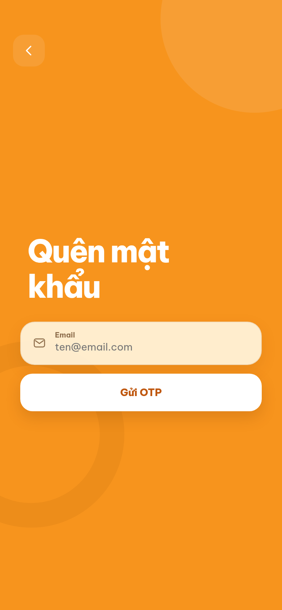
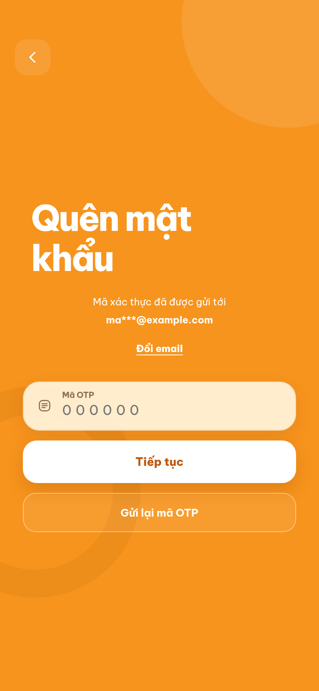

# UC-03 — Quên mật khẩu bằng email OTP

## 1. Mô tả Use Case

### 1.1 Thông tin chung

| Trường | Nội dung |
| --- | --- |
| Mã Use Case | UC-03 |
| Tên Use Case | Quên mật khẩu bằng email OTP |
| Mục tiêu | Chủ trọ xác minh quyền kiểm soát email và thiết lập mật khẩu mới cho tài khoản SmartChủ. |
| Phạm vi | SmartChủ / Khôi phục mật khẩu |
| Tác nhân chính | Chủ trọ |
| Tác nhân phụ/Hệ thống liên quan | Hệ thống SmartChủ; dịch vụ gửi email |
| Sự kiện kích hoạt | Chủ trọ chọn `Quên mật khẩu` tại màn hình Đăng nhập. |
| Tiền điều kiện | Chủ trọ chưa đăng nhập; có thể truy cập email đã dùng để đăng ký tài khoản. |
| Hậu điều kiện thành công | Mật khẩu được cập nhật; mọi phiên cũ của tài khoản bị thu hồi; chủ trọ được đưa về Đăng nhập với email điền sẵn và không tự động đăng nhập. |
| Đảm bảo tối thiểu khi không thành công | Mật khẩu không thay đổi; không tạo phiên mới; phản hồi yêu cầu OTP không làm lộ email có tồn tại hay không. |

### 1.2 Luồng chính

| Bước | Tác nhân/Hệ thống | Hành động hoặc phản hồi | Điều kiện/Quy tắc |
| --- | --- | --- | --- |
| M1 | Chủ trọ | Mở SmartChủ và chọn `Quên mật khẩu`. |  |
| M2 | Hệ thống SmartChủ | Hiển thị màn hình Quên mật khẩu / Email. |  |
| M3 | Chủ trọ | Nhập email đã dùng đăng ký và chọn `Gửi OTP`. |  |
| M4 | Hệ thống SmartChủ | Chuẩn hóa email, kiểm tra định dạng, giới hạn yêu cầu và điều kiện khôi phục mật khẩu. |  |
| M5 | Hệ thống SmartChủ | Gửi OTP 6 chữ số nếu tài khoản đủ điều kiện; luôn hiển thị phản hồi trung tính và màn hình nhập OTP. | Không tiết lộ trạng thái tài khoản. |
| M6 | Chủ trọ | Nhập OTP và chọn `Tiếp tục`. | OTP gồm đủ 6 chữ số. |
| M7 | Hệ thống SmartChủ | Xác thực OTP. | OTP đúng, còn hạn và chưa vượt số lần thử. |
| M8 | Hệ thống SmartChủ | Cấp quyền đặt lại mật khẩu dùng một lần và hiển thị màn hình Mật khẩu mới. | OTP hợp lệ. |
| M9 | Chủ trọ | Nhập mật khẩu mới, xác nhận mật khẩu và chọn `Xác nhận`. | Hai giá trị hợp lệ và trùng nhau. |
| M10 | Hệ thống SmartChủ | Kiểm tra và cập nhật mật khẩu. | Quyền đặt lại mật khẩu còn hiệu lực. |
| M11 | Hệ thống SmartChủ | Thu hồi toàn bộ phiên hiện có của tài khoản. | Mật khẩu cập nhật thành công. |
| M12 | Hệ thống SmartChủ | Chuyển về Đăng nhập với email điền sẵn, không tự động đăng nhập. |  |

### 1.3 Luồng thay thế

#### A1. Email không tồn tại hoặc tài khoản không đủ điều kiện khôi phục

- Bắt đầu tại: `M4`
- Điều kiện: Email không gắn với tài khoản có thể khôi phục bằng mật khẩu.

| Bước | Tác nhân/Hệ thống | Hành động hoặc phản hồi |
| --- | --- | --- |
| A1.1 | Hệ thống SmartChủ | Không gửi OTP. |
| A1.2 | Hệ thống SmartChủ | Hiển thị cùng phản hồi trung tính và màn hình nhập OTP như trường hợp đủ điều kiện. |

- Kết quả/Điểm quay lại: Tiếp tục tại `M6`; không cho phép hoàn tất khôi phục nếu không có OTP hợp lệ.

#### A2. Gửi lại OTP

- Bắt đầu tại: `M6`
- Điều kiện: Chủ trọ chưa nhận được mã hoặc mã đã hết hạn và thời gian chờ gửi lại đã kết thúc.

| Bước | Tác nhân/Hệ thống | Hành động hoặc phản hồi |
| --- | --- | --- |
| A2.1 | Chủ trọ | Chọn `Gửi lại mã OTP`. |
| A2.2 | Hệ thống SmartChủ | Kiểm tra giới hạn, gửi OTP mới nếu đủ điều kiện và vô hiệu OTP cũ. |
| A2.3 | Hệ thống SmartChủ | Đặt lại thời gian chờ và giữ màn hình nhập OTP. |

- Kết quả/Điểm quay lại: Quay lại `M6`.

#### A3. Đổi email khôi phục

- Bắt đầu tại: `M6`
- Điều kiện: Chủ trọ muốn sử dụng email khác.

| Bước | Tác nhân/Hệ thống | Hành động hoặc phản hồi |
| --- | --- | --- |
| A3.1 | Chủ trọ | Chọn `Đổi email`. |
| A3.2 | Hệ thống SmartChủ | Xóa OTP đang nhập và quay về màn hình Email. |

- Kết quả/Điểm quay lại: Quay lại `M3`.

### 1.4 Luồng ngoại lệ

#### E1. Email sai định dạng hoặc vượt giới hạn yêu cầu

- Bắt đầu tại: `M4`
- Điều kiện: Email sai định dạng hoặc yêu cầu vượt giới hạn tần suất.

| Bước | Tác nhân/Hệ thống | Hành động hoặc phản hồi |
| --- | --- | --- |
| E1.1 | Hệ thống SmartChủ | Không gửi OTP và hiển thị lỗi định dạng hoặc thông báo thử lại sau. |
| E1.2 | Chủ trọ | Sửa email hoặc chờ hết giới hạn. |

- Kết quả/Điểm quay lại: Quay lại `M3`.

#### E2. OTP không hợp lệ

- Bắt đầu tại: `M7`
- Điều kiện: OTP sai, hết hạn, đã dùng, đã bị thay thế hoặc vượt số lần thử.

| Bước | Tác nhân/Hệ thống | Hành động hoặc phản hồi |
| --- | --- | --- |
| E2.1 | Hệ thống SmartChủ | Từ chối xác minh và hiển thị lỗi phù hợp. |
| E2.2 | Chủ trọ | Nhập lại hoặc yêu cầu mã mới khi đủ điều kiện. |

- Kết quả/Điểm quay lại: Quay lại `M6`.

#### E3. Mật khẩu mới hoặc quyền đặt lại không hợp lệ

- Bắt đầu tại: `M10`
- Điều kiện: Mật khẩu không đạt chính sách, hai giá trị không khớp hoặc quyền đặt lại đã hết hạn/đã dùng.

| Bước | Tác nhân/Hệ thống | Hành động hoặc phản hồi |
| --- | --- | --- |
| E3.1 | Hệ thống SmartChủ | Không cập nhật mật khẩu và hiển thị lỗi tương ứng. |
| E3.2 | Chủ trọ | Nhập lại mật khẩu hoặc bắt đầu lại luồng nếu quyền đặt lại không còn hiệu lực. |

- Kết quả/Điểm quay lại: Quay lại `M9` hoặc kết thúc và trở về Đăng nhập.

### 1.5 Quy tắc nghiệp vụ

| Mã | Quy tắc nghiệp vụ | Áp dụng tại bước |
| --- | --- | --- |
| BR-01 | Phản hồi công khai sau yêu cầu OTP phải trung tính, không xác nhận email có tồn tại hay tài khoản có đủ điều kiện khôi phục mật khẩu. | M4-M5, A1 |
| BR-02 | OTP gồm 6 chữ số, có hiệu lực 10 phút và tối đa 5 lần nhập sai cho mỗi lần xác minh. | M5-M7 |
| BR-03 | Gửi lại OTP có thời gian chờ tối thiểu 60 giây; OTP mới làm OTP cũ mất hiệu lực. | A2 |
| BR-04 | Quyền đặt lại mật khẩu chỉ dùng một lần, có hiệu lực 10 phút và không được lưu hoặc ghi log dưới dạng đọc được ở client. | M8-M10 |
| BR-05 | Mật khẩu mới có tối thiểu 8 ký tự, gồm ít nhất một chữ hoa, một chữ số và một ký tự đặc biệt; xác nhận phải trùng khớp. | M9-M10 |
| BR-06 | Đặt lại mật khẩu thành công phải thu hồi toàn bộ phiên và thông tin làm mới phiên hiện có của tài khoản. | M11 |
| BR-07 | OTP, quyền đặt lại và mật khẩu không được đưa vào tham số điều hướng, dữ liệu phân tích, nhật ký hoặc vùng lưu trữ bền vững. | M6-M11 |
| BR-08 | Khi ứng dụng chuyển nền rồi quay lại và phiên khôi phục còn hiệu lực, hệ thống giữ bước cùng email; sau khi tiến trình bị đóng, chủ trọ bắt đầu lại luồng. | M5-M10 |
| BR-09 | Tài khoản chỉ dùng xác thực qua mạng xã hội nằm ngoài phạm vi UC này; hệ thống không tự tạo mật khẩu hoặc tự liên kết nhà cung cấp. | M4 |

## 2. Activity Diagram

- File nguồn: [SmartChu-auth-email.drawio.xml](../activity-diagrams/SmartChu-auth-email.drawio.xml)
- Page: `AD_Forgot Password`

## 3. Mô tả màn hình

### 01 — Đăng nhập

#### Thông tin chung

| Trường | Nội dung |
| --- | --- |
| Mã màn hình | 01 |
| Tên màn hình | Đăng nhập |
| Mục đích | Cung cấp điểm vào luồng khôi phục mật khẩu. |
| Điểm vào | Chủ trọ mở ứng dụng khi chưa đăng nhập. |
| Điểm ra/Điều hướng | `Quên mật khẩu` mở màn hình 06. |
| Vai trò/Quyền | Chủ trọ chưa đăng nhập. |

#### Thành phần giao diện

| STT | Thành phần | Loại | Nội dung/Dữ liệu hiển thị | Bắt buộc | Có thể chỉnh sửa | Validation/Định dạng | Điều kiện hiển thị |
| --- | --- | --- | --- | --- | --- | --- | --- |
| 1 | Quên mật khẩu | Liên kết | `Quên mật khẩu` | Không | Không | Không áp dụng | Luôn hiển thị. |

#### Thao tác

| Thao tác | Điều kiện khả dụng | Xác nhận | Hệ thống xử lý | Kết quả/Điều hướng | Phản hồi lỗi |
| --- | --- | --- | --- | --- | --- |
| Chọn `Quên mật khẩu` | Luôn khả dụng | Không | Khởi tạo luồng khôi phục mật khẩu. | Mở màn hình 06. | Giữ màn hình nếu không thể điều hướng. |

#### Trạng thái màn hình

| Trạng thái | Điều kiện | Hiển thị/Hành vi |
| --- | --- | --- |
| Ban đầu | Chưa đăng nhập | Hiển thị link `Quên mật khẩu`. |

### 06 — Quên mật khẩu / Email

#### Thông tin chung

| Trường | Nội dung |
| --- | --- |
| Mã màn hình | 06 |
| Tên màn hình | Quên mật khẩu / Email |
| Mục đích | Thu thập email dùng để yêu cầu OTP khôi phục mật khẩu. |
| Điểm vào | Từ `Quên mật khẩu` tại màn hình 01 hoặc `Đổi email` tại màn hình 07. |
| Điểm ra/Điều hướng | Yêu cầu hợp lệ mở màn hình 07; quay lại trở về màn hình 01. |
| Vai trò/Quyền | Chủ trọ chưa đăng nhập. |

#### Thành phần giao diện

| STT | Thành phần | Loại | Nội dung/Dữ liệu hiển thị | Bắt buộc | Có thể chỉnh sửa | Validation/Định dạng | Điều kiện hiển thị |
| --- | --- | --- | --- | --- | --- | --- | --- |
| 1 | Email | Trường nhập | Email đã dùng đăng ký | Có | Có | Định dạng email; trim; không tự viết hoa | Luôn hiển thị. |
| 2 | Gửi OTP | Nút chính | `Gửi OTP` | Không | Không | Chỉ khả dụng khi email hợp lệ và không đang xử lý | Luôn hiển thị. |

#### Thao tác

| Thao tác | Điều kiện khả dụng | Xác nhận | Hệ thống xử lý | Kết quả/Điều hướng | Phản hồi lỗi |
| --- | --- | --- | --- | --- | --- |
| Chọn `Gửi OTP` | Email hợp lệ | Không | Kiểm tra giới hạn, gửi OTP nếu đủ điều kiện và trả phản hồi trung tính. | Mở màn hình 07. | Lỗi định dạng hiển thị tại trường; vượt giới hạn tần suất thì yêu cầu thử lại sau. |
| Quay lại | Không đang xử lý | Không | Hủy phiên khôi phục trên thiết bị. | Về màn hình 01. | Không áp dụng. |

#### Trạng thái màn hình

| Trạng thái | Điều kiện | Hiển thị/Hành vi |
| --- | --- | --- |
| Ban đầu | Email chưa hợp lệ | Nút `Gửi OTP` chưa khả dụng. |
| Đang gửi | Đã gửi yêu cầu | Khóa thao tác gửi lặp. |
| Lỗi validation | Email sai định dạng | Hiển thị lỗi tại trường email. |
| Bị giới hạn | Yêu cầu vượt giới hạn tần suất | Hiển thị thông báo thử lại sau. |

### 07 — Quên mật khẩu / OTP

#### Thông tin chung

| Trường | Nội dung |
| --- | --- |
| Mã màn hình | 07 |
| Tên màn hình | Quên mật khẩu / OTP |
| Mục đích | Xác minh OTP trước khi cho phép đặt mật khẩu mới. |
| Điểm vào | Sau phản hồi yêu cầu OTP tại màn hình 06. |
| Điểm ra/Điều hướng | OTP hợp lệ mở màn hình 08; `Đổi email` quay về màn hình 06. |
| Vai trò/Quyền | Chủ trọ có phiên khôi phục hiện tại. |

#### Thành phần giao diện

| STT | Thành phần | Loại | Nội dung/Dữ liệu hiển thị | Bắt buộc | Có thể chỉnh sửa | Validation/Định dạng | Điều kiện hiển thị |
| --- | --- | --- | --- | --- | --- | --- | --- |
| 1 | Nơi nhận mã | Văn bản | `Mã xác thực đã được gửi tới` và email masked ở dòng riêng | Không | Không | Email được che một phần | Luôn hiển thị. |
| 2 | Đổi email | Liên kết | `Đổi email` | Không | Không | Không áp dụng | Luôn hiển thị. |
| 3 | OTP | Trường nhập | Mã xác thực | Có | Có | Tối đa 6 chữ số; cho phép dán mã | Luôn hiển thị. |
| 4 | Gửi lại mã | Liên kết/Nút phụ | `Gửi lại mã OTP` kèm thời gian chờ | Không | Không | Theo giới hạn gửi lại | Luôn hiển thị. |
| 5 | Tiếp tục | Nút chính | `Tiếp tục` | Không | Không | Chỉ khả dụng khi đủ 6 số và không đang xử lý | Luôn hiển thị. |

#### Thao tác

| Thao tác | Điều kiện khả dụng | Xác nhận | Hệ thống xử lý | Kết quả/Điều hướng | Phản hồi lỗi |
| --- | --- | --- | --- | --- | --- |
| Chọn `Tiếp tục` | OTP đủ 6 số | Không | Xác thực OTP và cấp quyền reset dùng một lần. | Mở màn hình 08. | Hiển thị lỗi OTP tương ứng. |
| Chọn `Gửi lại mã OTP` | Thời gian chờ kết thúc | Không | Gửi OTP mới nếu đủ điều kiện; vô hiệu OTP cũ. | Ở lại màn hình và đặt lại thời gian chờ. | Thông báo không thể gửi lại. |
| Chọn `Đổi email` | Luôn khả dụng | Không | Xóa OTP đã nhập. | Quay về màn hình 06. | Không áp dụng. |

#### Trạng thái màn hình

| Trạng thái | Điều kiện | Hiển thị/Hành vi |
| --- | --- | --- |
| Chờ nhập | OTP chưa đủ 6 số | Nút `Tiếp tục` chưa khả dụng. |
| Đang xác thực | Đã gửi OTP để kiểm tra | Khóa thao tác gửi lặp. |
| Đang chờ gửi lại | Chưa thể gửi lại | Hiển thị thời gian còn lại. |
| Lỗi OTP | OTP không hợp lệ | Giữ màn hình và cho phép nhập lại theo giới hạn. |

### 08 — Quên mật khẩu / Mật khẩu mới

#### Thông tin chung

| Trường | Nội dung |
| --- | --- |
| Mã màn hình | 08 |
| Tên màn hình | Quên mật khẩu / Mật khẩu mới |
| Mục đích | Cho phép chủ trọ đặt mật khẩu mới sau khi xác minh OTP. |
| Điểm vào | Sau khi OTP khôi phục hợp lệ. |
| Điểm ra/Điều hướng | Thành công về màn hình 01 với email điền sẵn; phiên khôi phục hết hạn cũng trở về màn hình 01. |
| Vai trò/Quyền | Chủ trọ có quyền reset dùng một lần còn hiệu lực. |

#### Thành phần giao diện

| STT | Thành phần | Loại | Nội dung/Dữ liệu hiển thị | Bắt buộc | Có thể chỉnh sửa | Validation/Định dạng | Điều kiện hiển thị |
| --- | --- | --- | --- | --- | --- | --- | --- |
| 1 | Mật khẩu mới | Trường mật khẩu | Mật khẩu thay thế | Có | Có | Tối thiểu 8 ký tự, có chữ hoa, chữ số và ký tự đặc biệt | Luôn hiển thị. |
| 2 | Xác nhận mật khẩu | Trường mật khẩu | Nhập lại mật khẩu mới | Có | Có | Phải trùng mật khẩu mới | Luôn hiển thị. |
| 3 | Hiện/ẩn mật khẩu | Nút biểu tượng | Đổi trạng thái che ký tự | Không | Không | Không thay đổi giá trị | Khi trường mật khẩu hiển thị. |
| 4 | Xác nhận | Nút chính | `Xác nhận` | Không | Không | Chỉ khả dụng khi hai trường hợp lệ và khớp | Luôn hiển thị. |

#### Thao tác

| Thao tác | Điều kiện khả dụng | Xác nhận | Hệ thống xử lý | Kết quả/Điều hướng | Phản hồi lỗi |
| --- | --- | --- | --- | --- | --- |
| Chọn `Xác nhận` | Hai mật khẩu hợp lệ; quyền reset còn hiệu lực | Không | Cập nhật mật khẩu và thu hồi toàn bộ phiên cũ. | Về màn hình 01 với email điền sẵn. | Hiển thị lỗi mật khẩu hoặc yêu cầu bắt đầu lại khi quyền reset hết hạn. |

#### Trạng thái màn hình

| Trạng thái | Điều kiện | Hiển thị/Hành vi |
| --- | --- | --- |
| Ban đầu | Chưa nhập đủ hai trường | Nút `Xác nhận` chưa khả dụng. |
| Lỗi validation | Mật khẩu không đạt chính sách hoặc không khớp | Hiển thị lỗi tương ứng. |
| Đang cập nhật | Đã gửi yêu cầu hợp lệ | Khóa thao tác gửi lặp. |
| Thành công | Mật khẩu đã cập nhật và phiên cũ đã thu hồi | Về Đăng nhập, không auto-login. |
| Hết hạn/Lỗi xử lý | Quyền reset hết hạn hoặc cập nhật thất bại | Không đổi mật khẩu; cho phép bắt đầu lại khi cần. |
