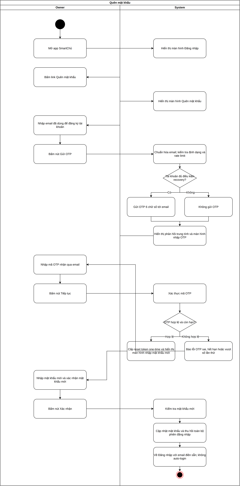
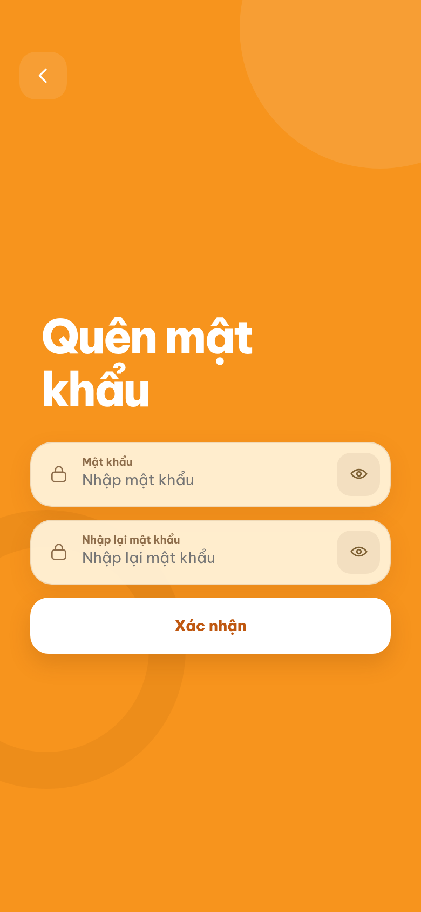

# SmartChủ — UC-03 Forgot Password by Email OTP

## 1. Metadata

| Thuộc tính | Giá trị |
| --- | --- |
| Use Case | `UC-03` — Quên mật khẩu bằng Email OTP |
| Actor | Chủ trọ |
| Trạng thái | Draft — canonical Auth canvas đã bổ sung; implementation gate chưa mở |
| Ngày cập nhật | 2026-11-18 |
| Parent task | `GLI-90` |
| Source lịch sử | `SRS/SRS (SmartChủ).docx` |

## 1.1. Canonical design reference

- Editable artifact: [`smartchu-auth-flow-canvas-2026-11-18.zip`](../assets/auth/smartchu-auth-flow-canvas-2026-11-18.zip).
- Artboard thuộc UC-03: `06 - Quên mật khẩu / Email`, `07 - Quên mật khẩu / OTP`, `08 - Quên mật khẩu / Mật khẩu mới`.
- OTP destination block dùng cùng pattern với Sign Up: `Mã xác thực đã được gửi tới` → email masked được nhấn mạnh ở dòng riêng → `Đổi email`.
- Tiêu đề và back navigation vẫn theo ngữ cảnh recovery; canvas không thay anti-enumeration, reset-token, revoke-session hoặc API behavior.

Capture happy path được đặt tại đúng đặc tả màn hình ở mục 4. ZIP ở trên chỉ dùng khi cần mở/chỉnh editable canvas.

- Activity Diagram canonical: [`SmartChu-auth-email.drawio.xml`](../activity-diagrams/SmartChu-auth-email.drawio.xml), page `AD_Forgot Password`, page ID `tZYZ2J0cIpiNvWy0H8DZ`.
- Node trọng tâm: nhập email `OKeWYJX48u6LaeIK9Js--7`, eligibility decision `OKeWYJX48u6LaeIK9Js--23`, OTP decision `OKeWYJX48u6LaeIK9Js--40`, reset/revoke session `OKeWYJX48u6LaeIK9Js--46`.

### Activity Diagram render — Forgot Password

PNG này là bản đọc/review được export trực tiếp từ page canonical nêu trên; mọi thay đổi XML phải regenerate ảnh trong cùng revision.

## 2. Mục tiêu và thay đổi nguồn

Chủ trọ khôi phục mật khẩu qua email OTP 6 chữ số. Đề xuất này thay thế flow số điện thoại/SMS và các thông báo có khả năng làm lộ tài khoản trong SRS cũ.

## 3. Luồng đề xuất

1. Màn Email: người dùng nhập email và yêu cầu mã.
2. Hệ thống luôn trả thông báo trung tính: `Nếu email tồn tại, mã xác thực đã được gửi.`
3. Màn OTP: người dùng nhập OTP 6 chữ số; có gửi lại OTP theo cooldown và có cơ chế nhập email khác theo design được duyệt.
4. Sau OTP hợp lệ, backend cấp reset token một lần.
5. Màn Mật khẩu mới: người dùng nhập mật khẩu và xác nhận.
6. Hệ thống đổi mật khẩu, thu hồi toàn bộ session hiện có và đưa người dùng về Sign In với email prefill; không auto-login.

Ba bước Email → OTP → Mật khẩu mới là ba màn riêng. Không tự thêm input OTP inline vào màn Email.

## 4. UI specification

### 4.1. Màn nhập email recovery

- Field `Email` bắt buộc; trim/lowercase theo shared identity normalization.
- Primary action `Gửi OTP`; chặn double-submit và không gửi request khi format sai.
- Public response luôn trung tính `Nếu email tồn tại, mã xác thực đã được gửi.`.
- Back quay về Sign In; không persist recovery state qua restart.

### 4.2. Màn nhập OTP recovery

- Destination block: `Mã xác thực đã được gửi tới`, email masked ở dòng riêng được nhấn mạnh, sau đó là action `Đổi email`.
- OTP chỉ nhận 6 chữ số; `Tiếp tục` disabled khi chưa đủ mã hoặc đang verify.
- `Gửi lại mã OTP` tuân theo cooldown; `Đổi email` quay về màn email và xóa OTP đang nhập.
- Lỗi tối thiểu: OTP sai, hết hạn, bị thay thế, đã dùng hoặc vượt số lần thử.

### 4.3. Màn tạo mật khẩu mới

- Hai field mật khẩu mới và xác nhận mật khẩu; có show/hide và không persist/log.
- Primary action `Xác nhận` chỉ khả dụng khi hai field hợp lệ và khớp nhau.
- Thành công: đổi mật khẩu, thu hồi toàn bộ session và về Sign In với email prefill; không auto-login.

## 5. Rules

- Response request OTP không xác nhận email tồn tại.
- OTP: 6 chữ số, TTL `10 phút`, cooldown `60 giây`, OTP mới vô hiệu OTP cũ, tối đa 5 lần nhập sai.
- Reset token: dùng một lần, TTL `10 phút`, không lưu/log plaintext ở client.
- Password mới dùng policy của UC-01 và không được bằng credential không hợp lệ theo security policy chung.
- Reset thành công thu hồi mọi session/refresh token của account.
- App background/foreground giữ bước và email không nhạy cảm nếu process/state còn hợp lệ.
- Force-close/restart đưa người dùng về Sign In; người dùng bắt đầu lại Forgot Password nếu cần.
- Account social-only không thuộc phạm vi test UC này; phải được bao phủ trong UC social auth riêng, không tự tạo local password account hoặc tự link provider.

## 6. Acceptance Criteria

### AC-SMC-FP-01 — Request không enumeration

- **Given** người dùng nhập email tồn tại hoặc không tồn tại
- **When** yêu cầu mã khôi phục
- **Then** UI hiển thị cùng một thông báo trung tính
- **And** response public không cho phép suy ra trạng thái tài khoản.

### AC-SMC-FP-02 — OTP hợp lệ

- **Given** OTP hiện hành còn hạn và chưa vượt số lần thử
- **When** người dùng xác minh đúng
- **Then** hệ thống cấp quyền chuyển sang bước tạo mật khẩu mới bằng reset token một lần.

### AC-SMC-FP-03 — Đổi mật khẩu

- **Given** reset token hợp lệ và hai trường mật khẩu đúng policy/khớp nhau
- **When** người dùng xác nhận
- **Then** mật khẩu được thay đổi đúng một lần
- **And** mọi session cũ bị thu hồi
- **And** app trở về Sign In với email prefill, không auto-login.

### AC-SMC-FP-04 — App lifecycle

- **Given** người dùng đang ở OTP hoặc Password và chuyển app để đọc email
- **When** quay lại khi process/state còn hợp lệ
- **Then** bước hiện tại không bị dựng lại vô cớ
- **But when** app bị force-close/restart
- **Then** flow recovery không được phục hồi từ dữ liệu nhạy cảm đã persist.

## 7. Implementation notes

- Tái sử dụng email/OTP/reset infrastructure của `smart-platform-services`, không tạo implementation riêng cho SmartChủ.
- UI phải bám canonical SmartChủ canvas; Dev chỉ được bắt đầu sau khi PO mở FE gate và xác nhận đã hiểu phạm vi/component boundary.
- Mọi thay đổi về nút `Đổi email`, `Gửi lại mã OTP` hoặc thứ tự button phải được chốt ở design và cập nhật file này trước khi Dev code.

## 8. Điểm chờ PO review

- Xác nhận toàn bộ policy dùng chung với SmartTrọ UC-03.
- Xác nhận operational state ngoài happy path khi mở FE gate; wording/action canonical trên OTP là `Đổi email`.
