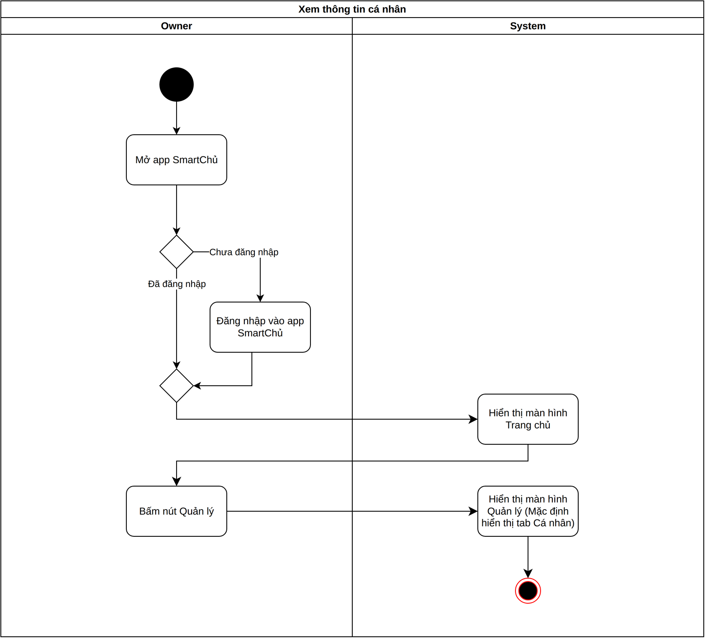
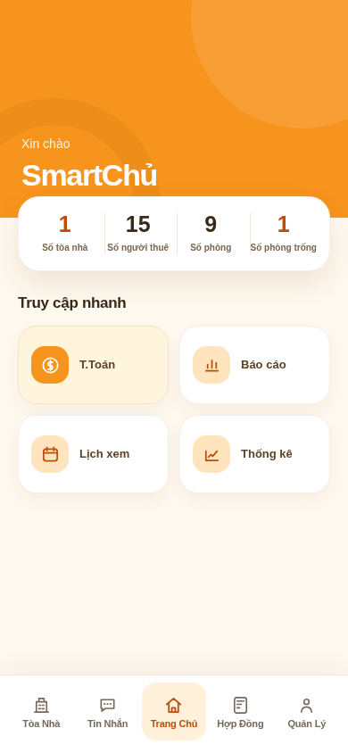
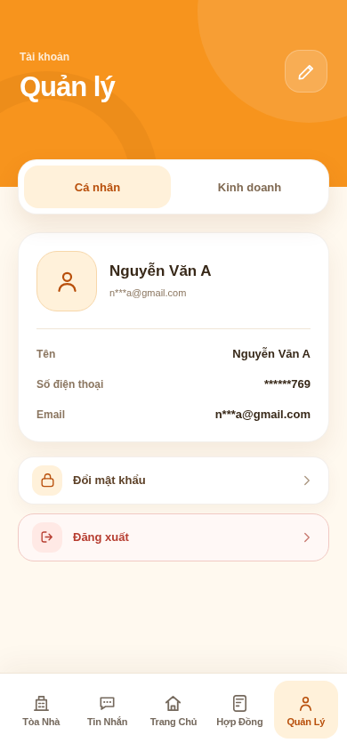

# UC-04 — Xem thông tin cá nhân

## 1. Mô tả Use Case

### 1.1 Thông tin chung

| Trường | Nội dung |
| --- | --- |
| Mã Use Case | UC-04 |
| Tên Use Case | Xem thông tin cá nhân |
| Mục tiêu | Chủ trọ xem thông tin cá nhân của chính mình trong khu vực Quản lý của SmartChủ. |
| Phạm vi | SmartChủ / Quản lý tài khoản cá nhân |
| Tác nhân chính | Chủ trọ |
| Tác nhân phụ/Hệ thống liên quan | Hệ thống SmartChủ |
| Sự kiện kích hoạt | Chủ trọ chọn `Quản lý` từ Trang chủ. |
| Tiền điều kiện | Chủ trọ có tài khoản SmartChủ và có phiên đăng nhập hợp lệ. |
| Hậu điều kiện thành công | Màn hình Quản lý mở tại tab `Cá nhân` và hiển thị đúng thông tin cá nhân của tài khoản hiện tại. |
| Đảm bảo tối thiểu khi không thành công | Không hiển thị thông tin của tài khoản khác và không cho phép truy cập dữ liệu bảo vệ khi phiên không hợp lệ. |

### 1.2 Luồng chính

| Bước | Tác nhân/Hệ thống | Hành động hoặc phản hồi | Điều kiện/Quy tắc |
| --- | --- | --- | --- |
| M1 | Chủ trọ | Mở ứng dụng SmartChủ. | Phiên đăng nhập còn hiệu lực. |
| M2 | Hệ thống SmartChủ | Hiển thị Trang chủ. |  |
| M3 | Chủ trọ | Chọn `Quản lý`. |  |
| M4 | Hệ thống SmartChủ | Mở màn hình Quản lý và chọn mặc định tab `Cá nhân`. |  |
| M5 | Hệ thống SmartChủ | Hiển thị avatar hoặc biểu tượng thay thế, tên hiển thị, email đã che một phần và số điện thoại liên hệ nếu đã được cung cấp. | Dữ liệu thuộc tài khoản đang đăng nhập. |
| M6 | Hệ thống SmartChủ | Hiển thị các lối điều hướng tới cập nhật thông tin cá nhân, đổi mật khẩu, đăng xuất và tab `Kinh doanh`. | Các chức năng được xử lý trong UC tương ứng. |

### 1.3 Luồng thay thế

#### A1. Chưa đăng nhập khi mở ứng dụng

- Bắt đầu tại: `M1`
- Điều kiện: Không có phiên đăng nhập hợp lệ.

| Bước | Tác nhân/Hệ thống | Hành động hoặc phản hồi |
| --- | --- | --- |
| A1.1 | Hệ thống SmartChủ | Hiển thị màn hình Đăng nhập. |
| A1.2 | Chủ trọ | Hoàn tất đăng nhập theo UC-02. |
| A1.3 | Hệ thống SmartChủ | Hiển thị Trang chủ. |

- Kết quả/Điểm quay lại: Tiếp tục tại `M3`.

#### A2. Chuyển sang tab Kinh doanh

- Bắt đầu tại: `M6`
- Điều kiện: Chủ trọ chọn tab `Kinh doanh`.

| Bước | Tác nhân/Hệ thống | Hành động hoặc phản hồi |
| --- | --- | --- |
| A2.1 | Hệ thống SmartChủ | Điều hướng sang bề mặt thông tin kinh doanh thuộc UC riêng. |
| A2.2 | Hệ thống SmartChủ | Chỉ hiển thị bề mặt future-feature trong phase đầu; không mở form hoặc quy trình UC-06/07 từ UC-04. |

- Kết quả/Điểm quay lại: Kết thúc UC-04 tại bề mặt thông tin kinh doanh.

### 1.4 Luồng ngoại lệ

Không có luồng ngoại lệ được xác định trong phạm vi Use Case này.

### 1.5 Quy tắc nghiệp vụ

| Mã | Quy tắc nghiệp vụ | Áp dụng tại bước |
| --- | --- | --- |
| BR-01 | Chỉ chủ tài khoản đang đăng nhập được xem thông tin cá nhân của chính mình. | M4-M5 |
| BR-02 | Email là credential identity đã xác minh và chỉ đọc trong phase đầu. | M5 |
| BR-03 | Số điện thoại là contact tùy chọn, không unique và không được dùng làm credential hoặc identity. | M5 |
| BR-04 | Avatar chỉ hiển thị ảnh backend khi có hoặc biểu tượng fallback khi thiếu/lỗi; phase đầu không có image picker hoặc upload avatar. | M5 |
| BR-05 | Không hiển thị `số phòng` hoặc `tên nhà trọ hiện đang thuê` vì đây là dữ liệu của actor Người thuê, không thuộc personal profile của Chủ trọ. | M5 |
| BR-06 | Personal profile và business profile là hai tab/domain riêng; full UC-06/07 không thuộc phạm vi phase đầu này. | M6, A2 |
| BR-07 | OTP không thuộc dữ liệu hồ sơ cá nhân và không xuất hiện trong UC-04. | M5 |

## 2. Activity Diagram

- File nguồn: [SmartChu-auth-email.drawio.xml](../activity-diagrams/SmartChu-auth-email.drawio.xml)
- Page: `AD_Profile Management (View Personal Profile)`

## 3. Mô tả màn hình

### Trang chủ — Trang chủ

#### Thông tin chung

| Trường | Nội dung |
| --- | --- |
| Mã màn hình | Trang chủ |
| Tên màn hình | Trang chủ |
| Mục đích | Cung cấp bề mặt sau đăng nhập và lối vào khu vực Quản lý. |
| Điểm vào | Sau khi đăng nhập thành công hoặc mở ứng dụng với phiên còn hiệu lực. |
| Điểm ra/Điều hướng | `Quản lý` mở màn hình Quản lý tại tab `Cá nhân`; các action khác thuộc UC riêng. |
| Vai trò/Quyền | Chủ trọ đã đăng nhập. |

#### Thành phần giao diện

| STT | Thành phần | Loại | Nội dung/Dữ liệu hiển thị | Bắt buộc | Có thể chỉnh sửa | Validation/Định dạng | Điều kiện hiển thị |
| --- | --- | --- | --- | --- | --- | --- | --- |
| 1 | Lời chào | Nội dung | `Xin chào` và tên sản phẩm `SmartChủ` | Không | Không | Không áp dụng | Khi có phiên hợp lệ. |
| 2 | Tổng quan vận hành | Nhóm chỉ số | Số tòa nhà, số người thuê, số phòng và số phòng trống | Không | Không | Giá trị số từ dữ liệu hệ thống | Khi có dữ liệu tương ứng. |
| 3 | Truy cập nhanh | Nhóm action | `T.Toán`, `Báo cáo`, `Lịch xem`, `Thống kê` | Không | Không | Destination thuộc UC tương ứng, không xác định trong UC-04 | Khi action được cung cấp cho tài khoản. |
| 4 | Điều hướng chính | Thanh điều hướng | `Tòa Nhà`, `Tin Nhắn`, `Trang Chủ`, `Hợp Đồng`, `Quản Lý` | Không | Không | `Trang Chủ` là mục đang chọn tại Trang chủ | Khi có phiên hợp lệ. |

#### Thao tác

| Thao tác | Điều kiện khả dụng | Xác nhận | Hệ thống xử lý | Kết quả/Điều hướng | Phản hồi lỗi |
| --- | --- | --- | --- | --- | --- |
| Chọn `Quản Lý` | Phiên hợp lệ | Không | Mở khu vực Quản lý. | Hiển thị màn hình Quản lý tại tab `Cá nhân`. | Chuyển về Đăng nhập nếu phiên không còn hợp lệ. |

#### Trạng thái màn hình

| Trạng thái | Điều kiện | Hiển thị/Hành vi |
| --- | --- | --- |
| Đã xác thực | Phiên còn hiệu lực | Hiển thị dữ liệu Home và cho phép mở Quản lý. |
| Phiên không hợp lệ | Phiên hết hạn hoặc bị thu hồi | Không hiển thị dữ liệu bảo vệ và chuyển về Đăng nhập. |

### Quản lý — Cá nhân

#### Thông tin chung

| Trường | Nội dung |
| --- | --- |
| Mã màn hình | Quản lý — Cá nhân |
| Tên màn hình | Quản lý thông tin cá nhân |
| Mục đích | Hiển thị thông tin cá nhân và các lối điều hướng quản lý tài khoản. |
| Điểm vào | Từ mục `Quản Lý` trên điều hướng chính. |
| Điểm ra/Điều hướng | Chỉnh sửa tới UC-05; `Đổi mật khẩu` tới UC-08; `Đăng xuất` tiếp tục UC-02; `Kinh doanh` tới bề mặt thuộc UC riêng. |
| Vai trò/Quyền | Chủ trọ đã đăng nhập; chỉ xem hồ sơ của chính mình. |

#### Thành phần giao diện

| STT | Thành phần | Loại | Nội dung/Dữ liệu hiển thị | Bắt buộc | Có thể chỉnh sửa | Validation/Định dạng | Điều kiện hiển thị |
| --- | --- | --- | --- | --- | --- | --- | --- |
| 1 | Chỉnh sửa | Nút biểu tượng | Mở cập nhật thông tin cá nhân | Không | Không | Không áp dụng | Khi tab `Cá nhân` đang được chọn. |
| 2 | Tab Cá nhân | Tab | Thông tin personal profile | Không | Không | Tab mặc định | Luôn hiển thị trong khu vực Quản lý. |
| 3 | Tab Kinh doanh | Tab | Lối sang bề mặt thông tin kinh doanh | Không | Không | Không mở form UC-06/07 trong phase đầu | Luôn hiển thị trong khu vực Quản lý. |
| 4 | Avatar | Hình ảnh/biểu tượng | Avatar backend hoặc biểu tượng fallback | Không | Không | Không có picker/upload trong phase đầu | Luôn hiển thị một trong hai dạng. |
| 5 | Tên hiển thị | Dữ liệu | Tên của chủ tài khoản | Có | Không | Dữ liệu personal profile | Luôn hiển thị. |
| 6 | Số điện thoại | Dữ liệu | Contact phone đã che một phần | Không | Không | Không unique, không credential | Chỉ hiển thị khi người dùng đã cung cấp. |
| 7 | Email | Dữ liệu | Email đã xác minh và che một phần | Có | Không | Read-only trong phase đầu | Luôn hiển thị. |
| 8 | Đổi mật khẩu | Action | `Đổi mật khẩu` | Không | Không | Không áp dụng | Khi có phiên hợp lệ. |
| 9 | Đăng xuất | Action | `Đăng xuất` | Không | Không | Chỉ xử lý một lần cho mỗi thao tác | Khi có phiên hợp lệ. |
| 10 | Điều hướng chính | Thanh điều hướng | `Tòa Nhà`, `Tin Nhắn`, `Trang Chủ`, `Hợp Đồng`, `Quản Lý` | Không | Không | `Quản Lý` là mục đang chọn | Khi có phiên hợp lệ. |

#### Thao tác

| Thao tác | Điều kiện khả dụng | Xác nhận | Hệ thống xử lý | Kết quả/Điều hướng | Phản hồi lỗi |
| --- | --- | --- | --- | --- | --- |
| Chọn biểu tượng chỉnh sửa | Tab `Cá nhân` đang được chọn | Không | Khởi tạo UC-05. | Mở màn hình cập nhật thông tin cá nhân. | Giữ màn hình nếu không thể điều hướng. |
| Chọn tab `Kinh doanh` | Phiên hợp lệ | Không | Mở bề mặt thông tin kinh doanh thuộc UC riêng. | Kết thúc UC-04 tại bề mặt future-feature của phase đầu. | Giữ tab `Cá nhân` nếu không thể điều hướng. |
| Chọn `Đổi mật khẩu` | Phiên hợp lệ | Không | Khởi tạo UC-08. | Mở màn hình Đổi mật khẩu. | Giữ màn hình nếu không thể điều hướng. |
| Chọn `Đăng xuất` | Phiên hợp lệ; không đang xử lý đăng xuất | Không | Tiếp tục luồng đăng xuất của UC-02. | Về Đăng nhập sau khi xóa phiên cục bộ. | UC-02 xử lý lỗi thu hồi phiên. |
| Chọn `Trang Chủ` | Phiên hợp lệ | Không | Mở Trang chủ. | Hiển thị Trang chủ. | Chuyển về Đăng nhập nếu phiên không hợp lệ. |

#### Trạng thái màn hình

| Trạng thái | Điều kiện | Hiển thị/Hành vi |
| --- | --- | --- |
| Cá nhân được chọn | Vừa mở khu vực Quản lý | Tab `Cá nhân` active và hiển thị personal profile. |
| Có avatar | Backend trả avatar hợp lệ | Hiển thị avatar của tài khoản. |
| Không có hoặc lỗi avatar | Không có avatar hoặc ảnh không tải được | Hiển thị biểu tượng fallback; không hiển thị picker/upload. |
| Không có số điện thoại | Người dùng chưa cung cấp contact phone | Không hiển thị dữ liệu phone giả. |
| Phiên không hợp lệ | Phiên hết hạn hoặc bị thu hồi | Không hiển thị dữ liệu hồ sơ và chuyển về Đăng nhập. |
